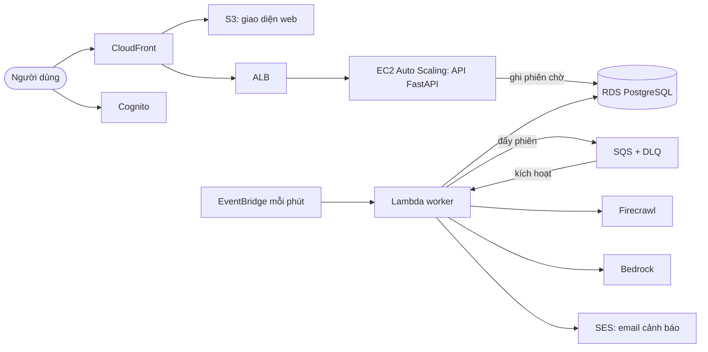

# Brand Auto-Tracking

Hệ thống theo dõi nhãn hàng tự động trên AWS — bài tập lớn môn Điện toán đám mây (Nhóm 6, lớp 2627I_INT3319E_2).

Doanh nghiệp đăng ký nhãn hàng và từ khóa; hệ thống tự thu thập bài viết, bình luận TikTok qua Firecrawl, phân loại cảm xúc bằng AI, **gửi email khi tỷ lệ bình luận tiêu cực tăng vượt ngưỡng** và dùng AI tóm tắt nguyên nhân kèm dẫn chứng.

- Web demo: https://d1ymt5wg42h5sa.cloudfront.net
- Đăng ký bằng email thật, xác minh bằng mã gửi qua email.

## Chức năng

| Chức năng | Mô tả |
|---|---|
| Tài khoản | Đăng ký, đăng nhập qua Amazon Cognito; dữ liệu mỗi tài khoản tách biệt |
| Nhãn hàng | Tên, từ khóa, nguồn TikTok, lịch thu thập; nút **Thu thập ngay** |
| Thu thập | Worker gọi Firecrawl lấy bài và bình luận, lưu vào PostgreSQL |
| Cảm xúc | Amazon Bedrock (Nova Lite) gán nhãn tích cực / trung lập / tiêu cực |
| Cảnh báo | So tỷ lệ tiêu cực giữa các lần thu thập, gửi email qua Amazon SES |
| Phân tích AI | Tóm tắt chủ đề và gợi ý, mỗi ý kèm bình luận dẫn chứng (chỉ để tham khảo) |

## Kiến trúc



Toàn bộ hạ tầng viết bằng **CloudFormation** (`infrastructure/`), khu vực `ap-southeast-1`. Mật khẩu database và khóa Firecrawl nằm trong **Secrets Manager**; log và cảnh báo vận hành ở **CloudWatch**. Chi tiết: [docs/architecture_aws.md](docs/architecture_aws.md).

## Công nghệ

- **Frontend:** React, TypeScript, Vite
- **Backend:** Python 3.12, FastAPI, SQLAlchemy, Alembic, PostgreSQL
- **AWS:** CloudFront, S3, Cognito, EC2, ALB, Auto Scaling, Lambda, SQS, EventBridge, RDS, VPC, NAT Gateway, Secrets Manager, Bedrock, SES, CloudWatch, CloudFormation
- **Thu thập:** Firecrawl (không gọi trực tiếp API mạng xã hội)

## Cấu trúc thư mục

```
backend/          API FastAPI, worker, migration Alembic, kiểm thử
frontend/         Giao diện React (build ra file tĩnh đặt trên S3)
infrastructure/   Template CloudFormation cho từng lớp hạ tầng
scripts/          Đóng gói Lambda, thử Firecrawl
demo/             Kiến trúc, lời thoại, thao tác demo, demo_control.py
docs/             SRS, kiến trúc, lộ trình, hồ sơ từng giai đoạn
report/           Báo cáo (HTML nguồn của bản PDF)
```

## Cài đặt và chạy cục bộ

Yêu cầu: Python 3.12, Node.js từ 20.19 trong nhánh 20, hoặc từ 22.12 trở lên, Docker (để chạy PostgreSQL).

**1. Backend** (PowerShell, tại `backend/`):

```powershell
python -m venv .venv
.\.venv\Scripts\Activate.ps1
pip install -r requirements.txt
$env:POSTGRES_PASSWORD = "<mật khẩu tự đặt>"
$env:DATABASE_URL = "postgresql+psycopg://brand_app:$env:POSTGRES_PASSWORD@127.0.0.1:54329/brand_tracking"
docker compose up -d --wait      # PostgreSQL cục bộ
alembic upgrade head             # tạo bảng
uvicorn app.main:app --reload    # API tại http://127.0.0.1:8000
```

Đăng nhập dùng Cognito: đặt `COGNITO_ISSUER`, `COGNITO_CLIENT_ID` và `CORS_ORIGINS=http://localhost:5173`. Xem [backend/README.md](backend/README.md).

**2. Frontend** (tại `frontend/`):

```powershell
npm install
$env:VITE_API_BASE_URL = "http://127.0.0.1:8000"
$env:VITE_COGNITO_DOMAIN = "<login domain của Cognito>"
$env:VITE_COGNITO_CLIENT_ID = "<app client id>"
npm run dev                      # http://localhost:5173
```

Không có Cognito, đặt `VITE_DEMO_MODE=true` để xem giao diện với dữ liệu mẫu.

**3. Kiểm thử**

```powershell
cd backend;  pip install -r requirements-dev.txt; python -m unittest discover -s tests
cd frontend; npm run build
```

## Triển khai lên AWS

Mỗi lớp là một stack CloudFormation, dựng theo thứ tự:

| # | Template | Tạo ra |
|---|---|---|
| 1 | `aws-demo-data.yaml` | VPC, subnet, NAT, RDS PostgreSQL, secret database |
| 2 | `cognito-demo.yaml` | User pool, app client, trang đăng nhập |
| 3 | `aws-demo-frontend.yaml` | S3 riêng tư + CloudFront |
| 4 | `aws-dev-api.yaml` | Lambda worker, SQS + DLQ, EventBridge, migration |
| 5 | `aws-demo-ec2-api.yaml` | EC2 Auto Scaling + ALB chạy API |

Đóng gói backend một lần cho cả Lambda và EC2:

```powershell
python scripts/package_lambda.py --output backend.zip
```

Tạo stack bằng `aws cloudformation deploy --template-file infrastructure/<template> --stack-name <tên> --parameter-overrides ...`. Tham số và thứ tự chi tiết: [infrastructure/README.md](infrastructure/README.md).

## Demo

Dữ liệu mô phỏng cho một nhãn hàng (không tốn credit Firecrawl):

```bat
python demo\demo_control.py start --stack <stack-api> --brand-id <mã nhãn hàng>
python demo\demo_control.py stop  --stack <stack-api>
```

Kịch bản đầy đủ: [demo/thao_tac_tung_buoc.md](demo/thao_tac_tung_buoc.md).

## Mở rộng

Phần thu thập được tách thành adapter riêng cho từng nguồn (`backend/app/adapters/`), nên có thể bổ sung nền tảng mà không phải thay đổi hạ tầng, hàng đợi hay phần phân tích:

- Hiện tại: **TikTok**.
- Sau này có thể mở rộng sang **Reddit**, **Facebook** và **Threads**: mỗi nền tảng thêm một adapter dùng Firecrawl, tuân thủ điều khoản sử dụng của nền tảng đó.

## Tài liệu

[Yêu cầu (SRS)](docs/software_requirements_specification.md) · [Kiến trúc AWS](docs/architecture_aws.md) · [Lộ trình](docs/development_roadmap.md) · [Cấu trúc dự án](docs/project_file_structure.md) · [Hồ sơ từng giai đoạn](docs/development-process/)
