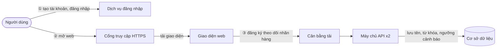
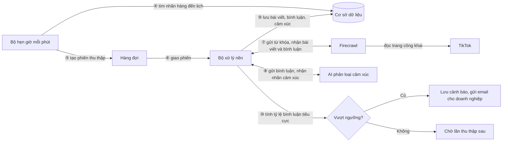
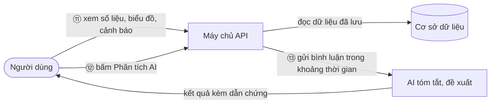

# Brand Auto Tracking — Kiến trúc trên AWS

## A. Ý tưởng xuất phát

Doanh nghiệp cần biết khách hàng đang nói gì về nhãn hàng của mình trên mạng xã hội. Hệ thống tự động thu thập bài viết và bình luận, phân tích cảm xúc, cảnh báo khi phản hồi tiêu cực tăng vượt ngưỡng, và dùng AI để tóm tắt, đề xuất hướng xử lý.

### Lý do chọn dự án

**1. Dịch vụ AWS**

- Trong chương trình học: EC2, Auto Scaling, Elastic Load Balancing, S3, CloudFront, VPC, RDS, Lambda, CloudWatch, IAM.
- Ngoài chương trình học: Cognito, SQS, EventBridge, Bedrock, SES, Secrets Manager, CloudFormation.
- **Kết luận:** dự án dùng đủ các nhóm dịch vụ trong khóa học (bảo mật, mạng và phân phối nội dung, tính toán, lưu trữ, cơ sở dữ liệu, tự động mở rộng và giám sát). Ngoài ra, nhóm dùng thêm 7 dịch vụ AWS ngoài chương trình học.

**2. Tính sáng tạo & Khả năng áp dụng thực tế**

- Với xu hướng phát triển của Internet, việc xây dựng thương hiệu và hình ảnh trực tuyến hay là bán hàng trực tuyến trở nên ngày càng phổ biến. Và mọi nhãn hàng hay thương hiệu đều cần thu thập những bài viết, bình luận, đánh giá về thương hiệu, hình ảnh của họ.
- Tuy nhiên, hiện giờ những việc trên đang được làm chủ yếu là thủ công. Với đặc thù lan truyền tốc độ, nhanh chóng của Internet thì việc nắm bắt thông tin sớm là điều vô cùng quan trọng. Ví dụ một cửa hàng có thể kịp thời xử lý bài đăng chê bai, phàn nàn về dịch vụ sớm và khiến nó không lây lan. Ngược lại, nếu như để những bài viết đó thành xu hướng thì lúc này xử lý sẽ rất phức tạp.

-> Hiện giờ chưa có nhiều dịch vụ hỗ trợ những nhãn hàng theo dõi tự động. Nên brand-autotracking là dự án mới mẻ. Đồng thời, với xu hướng ngày càng tăng về số lượng các nhãn hàng, cùng với tầm quan trọng của việc theo dõi, cập nhật thông tin thì brand-autotracking sẽ có tính áp dụng thực tế rất cao. 

## B. Kiến trúc tổng quan

Luồng hoạt động đi theo thứ tự ① → ⑬, qua ba giai đoạn.

### B1. Người dùng đăng ký theo dõi nhãn hàng



### B2. Hệ thống tự động theo dõi mỗi phút



### B3. Người dùng xem kết quả và hỏi AI



## C. Dịch vụ AWS

### 1. Truy cập và giao diện

| # | Dịch vụ | Khối trong sơ đồ | Vai trò |
|---|---|---|---|
| 1 | **CloudFront** | Cổng truy cập HTTPS | Địa chỉ web duy nhất; trả giao diện, chuyển `/api` về backend |
| 2 | **S3** | Giao diện web | Lưu các tệp giao diện React |
| 3 | **Cognito** | Dịch vụ đăng nhập | Đăng ký email có mã xác minh, đăng nhập, cấp token |

### 2. Máy chủ ứng dụng

| # | Dịch vụ | Khối trong sơ đồ | Vai trò |
|---|---|---|---|
| 4 | **Elastic Load Balancing (ALB)** | Cân bằng tải | Chia yêu cầu, chỉ gửi tới máy khỏe |
| 5 | **EC2** | Máy chủ API 1, 2 | Chạy API backend (FastAPI) |
| 6 | **Auto Scaling** | Máy chủ API 1, 2 | Luôn giữ 2 máy, tự thay máy hỏng, tự thêm máy khi tải cao |

### 3. Dữ liệu

| # | Dịch vụ | Khối trong sơ đồ | Vai trò |
|---|---|---|---|
| 7 | **RDS PostgreSQL** | Cơ sở dữ liệu | Lưu nhãn hàng, bình luận, cảnh báo; nằm trong mạng riêng |

### 4. Xử lý nền

| # | Dịch vụ | Khối trong sơ đồ | Vai trò |
|---|---|---|---|
| 8 | **EventBridge** | Bộ hẹn giờ | Kích hoạt thu thập mỗi phút |
| 9 | **SQS** | Hàng đợi | Xếp phiên chờ xử lý; DLQ giữ phiên lỗi |
| 10 | **Lambda** | Bộ xử lý nền | Thu thập, lưu, xét ngưỡng; chỉ chạy khi có việc |
| – | *Firecrawl (ngoài AWS)* | Firecrawl | Tìm bài trên TikTok theo từ khóa, lấy bình luận |

### 5. AI và thông báo

| # | Dịch vụ | Khối trong sơ đồ | Vai trò |
|---|---|---|---|
| 11 | **Bedrock** | AI phân loại cảm xúc, AI tóm tắt | Phân loại cảm xúc, tóm tắt, đề xuất |
| 12 | **SES** | Gửi email cho doanh nghiệp | Gửi email khi vượt ngưỡng. Worker lưu trạng thái và thử lại có giới hạn khi SES từ chối tạm thời. |

### 6. Nền tảng chung (không có khối riêng)

| # | Dịch vụ | Vai trò |
|---|---|---|
| 13 | **VPC** | Mạng riêng, chia subnet public / private |
| 14 | **IAM** | Cấp quyền tối thiểu cho từng thành phần |
| 15 | **Secrets Manager** | Giữ mật khẩu database, không để trong mã nguồn |
| 16 | **CloudWatch** | Ghi log, theo dõi chỉ số, cảnh báo vận hành |
| 17 | **CloudFormation** | Dựng toàn bộ hạ tầng bằng mã |

## D. Các lệnh cmd mô phỏng

> Phần dành cho người quay. Dán từng khối vào **cmd** (không phải PowerShell). Nếu tên stack đổi, sửa ở bước 0. Demo hệ thống làm theo [thao_tac_tung_buoc.md](thao_tac_tung_buoc.md) (không xen AWS Console); các lệnh xem dịch vụ dưới đây dùng cho phần trình diễn AWS làm sau. Lời thoại và trình tự demo dịch vụ: [demo_guide.md](demo_guide.md); thao tác chi tiết: [thao_tac_tung_buoc.md](thao_tac_tung_buoc.md).
> Dữ liệu demo là **giả lập**: 3 đợt bình luận có nhãn cảm xúc gán sẵn, không gọi Firecrawl. Các bước lưu, lập lịch, hàng đợi, cảnh báo và AI vẫn chạy thật trên AWS.

### 0. Chuẩn bị (trước khi bấm quay)

```bat
cd /d E:\TaiLieuHocTap\Nam3_Ky1\Cloud\brand-autotracking
set AWS_PROFILE=profile-name-logn
set AWS_REGION=ap-southeast-1
set API_STACK=brand-demo-minute-api-20261127
set EC2_STACK=brand-demo-minute-ec2-20261127
aws sso login
```

Kiểm tra nhanh, bỏ qua nếu đã xác nhận:

```bat
curl -s https://d1ymt5wg42h5sa.cloudfront.net/api/health
aws cloudformation list-stacks --stack-status-filter CREATE_COMPLETE UPDATE_COMPLETE --query "StackSummaries[?starts_with(StackName,'brand-demo-minute')].[StackName,StackStatus]" --output table
```

- Web: https://d1ymt5wg42h5sa.cloudfront.net. AWS Console: chọn Region **Singapore (ap-southeast-1)**.
- Tab **Phiên tracking** không còn phiên thu thập thật đang chờ.
- Nếu thiếu thư viện: `pip install boto3`.

### 1. Hạ tầng đang chạy: 2 máy EC2 sau Load Balancer

```bat
aws autoscaling describe-auto-scaling-groups --query "AutoScalingGroups[?starts_with(AutoScalingGroupName,'%EC2_STACK%')].Instances[].[InstanceId,AvailabilityZone,LifecycleState,HealthStatus]" --output table
```

→ Console: **EC2 → Target Groups → Targets** (2 máy `healthy`).

### 2. Sau khi tạo nhãn hàng trên web: xem log API

```bat
aws logs tail /brand-demo/%EC2_STACK%/api --since 5m
```

→ Console: **CloudWatch → Log groups**; **RDS → Databases**; **Cognito → Users** (tài khoản vừa tạo).

### 3. Bật dòng dữ liệu giả

Trước khi chạy: trên web, tab **Cảnh báo** → mục **Email nhận cảnh báo**, nhập email đã xác minh SES rồi bấm **Lưu người nhận** (SES đang sandbox nên chỉ gửi được tới địa chỉ đã xác minh).

Chép mã nhãn hàng trên web (nháy đúp ô chữ cái đại diện cạnh tên nhãn hàng), rồi dán thay chữ `DAN_MA_VAO_DAY`:

```bat
set BRAND_ID=DAN_MA_VAO_DAY
python demo\demo_control.py start --stack %API_STACK% --brand-id %BRAND_ID%
```

- Mặc định 2 đợt. Đợt 1 (mốc): **20/100** bình luận tiêu cực (20%). Khoảng 3 phút sau, đợt 2 đưa tỷ lệ lên **60/200** (30%, tăng 50%) và tạo **cảnh báo** kèm **email** gửi tới hộp thư đã nhập (có thể nằm trong Spam).
- Lệnh mất khoảng 1–2 phút vì CloudFormation cập nhật stack.

Xem lịch EventBridge đã bật:

```bat
aws events list-rules --name-prefix %API_STACK% --query "Rules[].[Name,State,ScheduleExpression]" --output table
```

Xem log worker. Lấy tên hàm trước, rồi dán vào lệnh thứ hai:

```bat
aws cloudformation describe-stacks --stack-name %API_STACK% --query "Stacks[0].Outputs[?OutputKey=='WorkerFunctionName'].OutputValue" --output text
set WORKER=DAN_TEN_HAM_VAO_DAY
aws logs tail /aws/lambda/%WORKER% --since 10m
```

→ Console: **EventBridge → Rules**, **Lambda → Monitor**, **SQS → Queues** (số tin có thể bằng 0 vì xử lý nhanh), **CloudWatch** (tìm `demo_queued`, `tracking_run`).

### 4. Phân tích AI (trong lúc chờ đợt 2)

Thao tác trên web, tab **Phân tích AI**: **Thu thập trước** đặt bằng giờ hiện tại. → Console: **CloudWatch → Metrics → Bedrock**.

Nhãn cảm xúc của dữ liệu giả được gán sẵn. Bedrock chỉ tạo bản tóm tắt và đề xuất.

### 5. (Không dùng) Đợt tích cực

Mặc định lệnh `start` chỉ chạy 2 đợt nên không còn đợt tích cực. Nếu muốn thêm, chạy `start` với `--batches 3`, rồi sau đợt 2 chạy `python demo\demo_control.py release --stack %API_STACK%` (65/300 ≈ 22%).

### 6. Kết thúc

```bat
python demo\demo_control.py stop --stack %API_STACK%
aws events list-rules --name-prefix %API_STACK% --query "Rules[].[Name,State]" --output table
```

Lệnh `stop` chỉ tắt lịch, **không** tắt EC2, ALB, RDS hay NAT. Khi đã quay xong và không cần quay lại, xóa stack EC2 (khoảng 2 USD/ngày):

```bat
aws cloudformation delete-stack --stack-name %EC2_STACK%
```

### Khi gặp sự cố

- **Không thấy đợt giả:** kiểm tra mã nhãn hàng và quy tắc cảnh báo đã lưu, rồi chờ thêm 1–2 phút và xem log worker.
- **`start` báo "Dừng lịch trước":** chạy lệnh `stop` rồi chạy lại `start`.
- **`aws` báo hết phiên:** chạy lại `aws sso login`.
- **AI lỗi hoặc chậm:** cắt đoạn đó khi dựng video, rồi thử lại sau.
