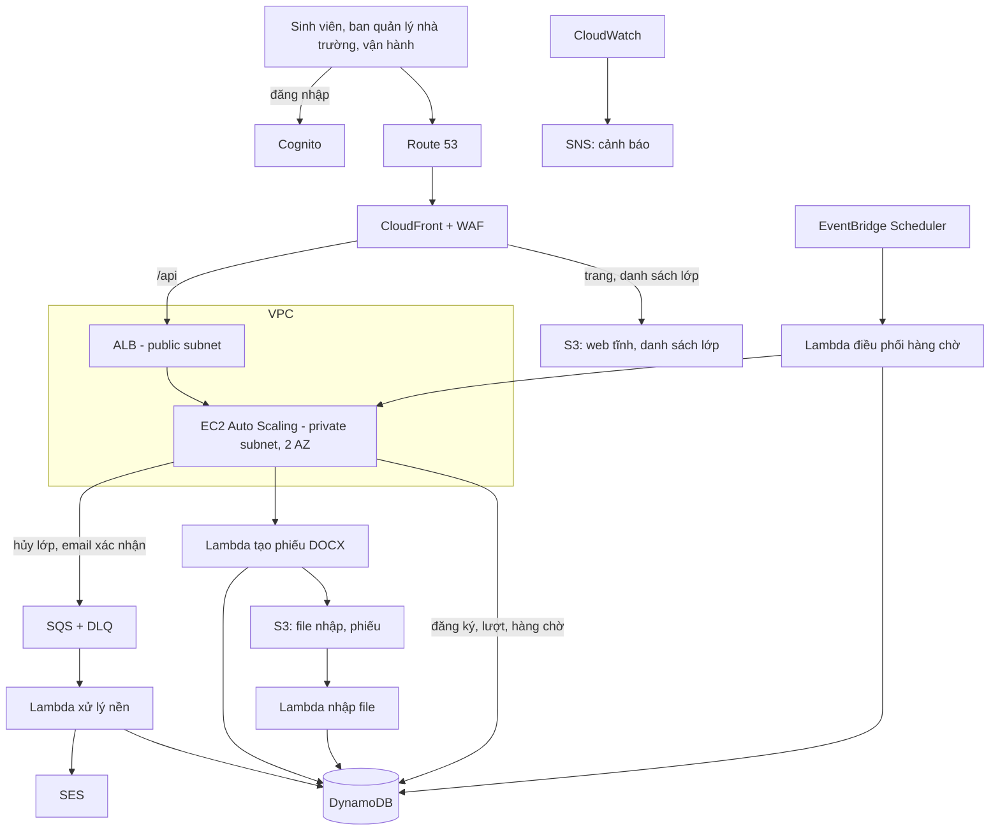

# Kiến trúc: Hệ thống đăng ký môn học trên AWS

| Thuộc tính | Nội dung |
|---|---|
| Phiên bản | 0.6 (đề xuất, chưa thử nghiệm) |
| Cập nhật | 09/11/2026 |
| Căn cứ | [SRS 0.8](software-requirements-specification.md) |
| Region đề xuất | ap-southeast-1 (Singapore) |

## 1. Ý tưởng chính

1. **Chặn tải càng sớm càng tốt.** Những gì nhiều người đọc giống nhau được phục vụ từ CloudFront và S3, không chạm vào máy chủ.
2. **Giới hạn người được ghi.** Hàng chờ chỉ cho một số sinh viên thao tác cùng lúc.
3. **Dữ liệu tập trung trên DynamoDB.** Các truy vấn chủ yếu đọc và ghi theo khóa, tải tăng đột ngột theo phiên, và ngày thường gần như không có người dùng.
4. **Việc nền đi qua hàng đợi.** Email và hủy lớp không làm chậm luồng đăng ký.
5. **Co giãn theo lịch.** Tăng công suất trước giờ mở và giảm khi hết nhu cầu.

## 2. Sơ đồ tổng thể

## 3. Dịch vụ và lý do chọn

Cột "Nếu không dùng" là câu trả lời khi được hỏi vì sao cần dịch vụ đó.

| Nhóm | Dịch vụ | Dùng để | Nếu không dùng |
|---|---|---|---|
| Mạng | VPC, subnet public và private, 2 AZ | Cô lập máy chủ ứng dụng | Máy chủ lộ ra Internet |
| Mạng | Gateway endpoint S3, DynamoDB | Đi nội bộ, không tốn phí NAT cho hai dịch vụ này | Toàn bộ lưu lượng này qua NAT |
| Mạng | Route 53, ACM (cần tên miền) | Tên miền và chứng chỉ HTTPS cho CloudFront và ALB | Dùng địa chỉ mặc định của CloudFront, đoạn CloudFront đến ALB không có TLS |
| Phân phối | CloudFront | Cache trang, danh sách lớp, số chỗ, vị trí hàng chờ | Mỗi lần tải lại đều vào máy chủ |
| Bảo mật | Security Group | Chỉ ALB vào được EC2 | Mở rộng bề mặt tấn công |
| Bảo mật | IAM role | Mỗi thành phần chỉ có quyền cần thiết | Phải lưu khóa truy cập trên máy |
| Bảo mật | KMS | Mã hóa dữ liệu khi lưu | Không đạt NFR-08 |
| Bảo mật | WAF | Chặn bot cơ bản, ngưỡng tần suất theo IP đặt cao vì cả trường có thể dùng chung IP | Tải rác đi thẳng vào hệ thống |
| Bảo mật | Cognito | Đăng nhập, nhóm theo 3 vai trò | Phải tự xây xác thực |
| Tính toán | EC2, ALB, Auto Scaling | API không giữ trạng thái, chịu lỗi một máy, co giãn | Một máy hỏng là dừng hệ thống |
| Tính toán | Lambda | Việc nền ngắn: điều phối, nhập file, tạo phiếu, gửi email, hủy lớp, đối soát | Phải giữ máy chạy cho việc ít khi xảy ra |
| Lưu trữ | S3 | Web tĩnh, file nhập, phiếu DOCX | Lưu trên máy chủ, mất khi máy bị thay |
| Cơ sở dữ liệu | DynamoDB on-demand, PITR | Toàn bộ dữ liệu của hệ thống; tính phí theo lượng dùng, tự sao chép qua nhiều AZ, khôi phục theo thời điểm | Phải vận hành máy chủ cơ sở dữ liệu theo công suất đỉnh, trả phí cả lúc vắng |
| Tích hợp | SQS, DLQ | Xếp hàng hủy lớp và email xác nhận, tự thử lại, giữ lại việc bị lỗi | Lỗi giữa chừng khó xử lý tiếp, API phải chờ việc nền |
| Tích hợp | EventBridge Scheduler | Mở, đóng phiên; tăng công suất; chạy Lambda điều phối | Phải thao tác tay đúng giờ |
| Tích hợp | SES, SNS | Email xác nhận cho sinh viên, cảnh báo cho vận hành | Sinh viên không có xác nhận qua email, vận hành khó biết sự cố |
| Giám sát | CloudWatch | Số đo, dashboard, cảnh báo | Không có số đo cho báo cáo |
| Chi phí | Budgets, Cost Explorer, Pricing Calculator | Kiểm soát và so sánh chi phí | Dễ phát sinh ngoài dự kiến |
| Tự động hóa | CloudFormation | Dựng và xóa toàn bộ theo từng stack | Khó tắt sau mỗi buổi, khó tái lập |

### Đối chiếu với đề cương học phần

Đề cương chỉ ghi chủ đề từng buổi, nên "ngoài bài dạy" ở đây nghĩa là đề cương không nêu tên.

| Nhóm | Dịch vụ |
|---|---|
| Có trong đề cương | VPC, Security Group, Route 53, CloudFront, IAM, EC2, Elastic Load Balancing, Auto Scaling, Lambda, S3, DynamoDB, CloudWatch, Pricing Calculator |
| Có khả năng thuộc chủ đề đã dạy, nhưng không nêu tên | KMS (thuộc "Bảo mật dữ liệu"), Budgets và Cost Explorer (thuộc "Quản lý thanh toán và chi phí") |
| Ngoài đề cương, là phần cộng thêm | SQS, SNS, SES, EventBridge, Cognito, WAF, ACM, CloudFormation |

## 4. Mô hình dữ liệu

Một bảng DynamoDB, thiết kế theo các truy vấn trong SRS.

| Dữ liệu | Khóa chính (PK, SK) | Phục vụ |
|---|---|---|
| Lớp, sĩ số, số đã đăng ký | `CLASS#mã`, `META` | Xem lớp, giữ đúng sĩ số |
| Hồ sơ sinh viên: version, tín chỉ, lịch đã đăng ký | `STUDENT#mã`, `META` | Kiểm tra điều kiện, chống gửi đồng thời |
| Kết quả học tập | `STUDENT#mã`, `RESULT#môn` | Môn tiên quyết, học lại, cải thiện |
| Đăng ký | `STUDENT#mã`, `REG#lớp` | Thời khóa biểu, phiếu |
| Lượt, thời điểm được vào lại | `STUDENT#mã`, `TURN` | BR-01, BR-02 |
| Vị trí hàng chờ | `SESSION#mã`, `QUEUE#mã sinh viên` | BR-03, BR-04 |
| Trạng thái phiên, số N | `SESSION#mã`, `META` | Mở, đóng phiên, chỉ đọc |

Một GSI theo mã lớp phục vụ danh sách sinh viên của lớp (FR-10, xuất danh sách). Một GSI theo thời điểm hết hạn của lượt phục vụ Lambda điều phối.

## 5. Các luồng chính

### 5.1. Xem lớp
- Danh sách lớp là file JSON trên S3, tạo khi công bố phiên và tạo lại khi lớp thay đổi. Trình duyệt tìm và lọc ngay trên file này (FR-02).
- Số chỗ còn lại là một API được CloudFront cache 10 giây.

### 5.2. Hàng chờ và lượt (BR-01 đến BR-05)
1. Sinh viên vào hàng: API từ chối nếu chưa hết thời gian chờ (BR-02), rồi ghi có điều kiện để mỗi người một vị trí.
2. Tại giờ mở, Lambda điều phối xếp ngẫu nhiên những người đang đợi. Người đến sau nhận số từ bộ đếm.
3. Trang web đọc "đang gọi đến số N" từ API được cache 5 giây rồi tự so với số của mình. Vì vậy 5.000 người cùng xem chỉ tạo rất ít yêu cầu đến máy chủ. Đến số của mình thì trang hiện lời mời và phát âm báo.
4. Lambda điều phối chạy lặp lại trong suốt phiên: kết thúc lượt hết giờ, thu hồi suất quá 5 phút và tăng N.
5. Sinh viên xác nhận thì hệ thống tạo bản ghi lượt, có thời điểm hết hạn. Mọi thao tác ghi đều kiểm tra bản ghi này, nên không giả mạo được từ phía trình duyệt.

Không dùng TTL của DynamoDB để kết thúc lượt, vì TTL có thể xóa rất trễ.

### 5.3. Đăng ký, đổi lớp (BR-10 đến BR-16)

API giới hạn tần suất theo tài khoản (BR-06), đọc trạng thái phiên và dữ liệu của sinh viên, kiểm tra điều kiện. Đọc thấy lớp đầy thì từ chối ngay; đạt thì ghi một transaction:

| Mục trong transaction | Điều kiện | Đảm bảo |
|---|---|---|
| Lớp: tăng số đã đăng ký | Số đã đăng ký nhỏ hơn sĩ số | Không vượt sĩ số |
| Sinh viên: tăng version, cập nhật tín chỉ và lịch | Version đúng như lúc đọc | Hai thiết bị gửi cùng lúc không thể lọt qua kiểm tra trùng lịch, tín chỉ, cùng môn |
| Đăng ký: tạo bản ghi | Chưa tồn tại | Gửi lại không tạo đăng ký trùng |
| Lượt: chỉ kiểm tra | Chưa hết hạn | Đúng BR-01 theo giờ của hệ thống |

Đổi lớp dùng cùng cách, thêm mục giảm số đã đăng ký của lớp cũ và xóa bản ghi cũ, nên là một thao tác trọn vẹn (FR-06). Sinh viên nhận kết quả ngay sau transaction.

Trạng thái phiên không nằm trong transaction, vì các transaction đồng thời cùng chứa một item có thể hủy lẫn nhau. Khi đóng phiên hoặc bật chỉ đọc, Lambda điều phối kết thúc mọi lượt, nên điều kiện về lượt chặn được mọi thao tác ghi còn lại.

### 5.4. Việc nền qua SQS
- **Email xác nhận (FR-17, Nên có):** API đưa tin vào hàng, Lambda gửi qua SES với số xử lý đồng thời được giới hạn theo tốc độ SES cho phép. Email có thể đến hai lần, không ảnh hưởng dữ liệu.
- **Hủy lớp (FR-10):** API đặt sĩ số về 0 để chặn đăng ký mới, rồi đưa mỗi sinh viên trong lớp thành một tin. Lambda dùng một transaction xóa đăng ký, hoàn tín chỉ và tạo thông báo; ghi có điều kiện để xử lý lại không bị trùng.
- **Khi lỗi:** tin lỗi lặp lại vào DLQ, CloudWatch báo qua SNS, vận hành gửi lại sau khi sửa.

### 5.5. Nhập dữ liệu và công bố phiên
1. Ban quản lý nhà trường tải file lên S3 bằng presigned URL.
2. Lambda kiểm tra toàn bộ file và trả báo cáo lỗi, chưa thay đổi dữ liệu. Có dòng lỗi thì dừng tại đây (FR-09).
3. Khi xác nhận, Lambda ghi theo lô; ghi lại không gây sai nên lỗi giữa chừng thì chạy lại. Sinh viên chưa thấy dữ liệu cho đến khi công bố phiên.
4. Khi công bố phiên, Lambda tạo danh sách lớp trên S3 và tạo lịch trên EventBridge Scheduler.

Thêm, sửa lớp khi phiên mở: API ghi có điều kiện (sĩ số không dưới số đã đăng ký), rồi tạo lại danh sách lớp.

### 5.6. Thống kê và đối soát
- **Thống kê (FR-18):** giữ bộ đếm số sinh viên bị từ chối theo lớp, ghi riêng để không ảnh hưởng transaction đăng ký.
- **Đối soát (FR-15):** sau khi đóng phiên, Lambda quét bảng, đếm lại đăng ký từng lớp để so với số đã đăng ký và sĩ số, kiểm tra trùng lịch và đăng ký trùng. Cần đo thời gian chạy với dữ liệu thật quy mô.

### 5.7. Co giãn
- **Theo lịch:** tăng số máy tối thiểu trước giờ mở phiên, vì máy mới cần vài phút để sẵn sàng.
- **Theo tải:** target tracking theo số yêu cầu trên mỗi máy.
- **Giảm:** khi hàng chờ rỗng và số lượt thấp trong một khoảng thời gian, Lambda điều phối hạ số máy tối thiểu.

### 5.8. Phiếu DOCX
API gọi Lambda tạo file, lưu nội dung và mã tra cứu vào DynamoDB, đưa file lên S3 rồi trả link có hạn. Việc tạo phiếu nặng không chạy trên máy phục vụ đăng ký.

### 5.9. Chế độ chỉ đọc và sự cố
- Vận hành bật cờ trong DynamoDB, API đọc cờ trước mọi thao tác ghi. Lambda điều phối được gọi ngay để kết thúc mọi lượt, không tính thời gian chờ, đánh dấu người bị ngắt; khi tắt cờ, nhóm này được cấp lại lượt trước khi N tăng tiếp (BR-07).
- Một máy hỏng: ALB ngừng gửi yêu cầu đến máy đó, Auto Scaling tạo máy mới.
- Một AZ gặp sự cố: máy ở AZ còn lại tiếp tục phục vụ; DynamoDB là dịch vụ cấp region.

## 6. Phân tách mạng

| Vùng | Thành phần | Nhận kết nối từ |
|---|---|---|
| Public subnet, 2 AZ | ALB, NAT Gateway | ALB chỉ nhận từ CloudFront (managed prefix list) |
| Private subnet, 2 AZ | EC2 | Chỉ từ ALB |

Lambda chạy ngoài VPC vì chỉ gọi các dịch vụ AWS. EC2 dùng gateway endpoint cho S3, DynamoDB và NAT cho các dịch vụ còn lại. Dùng một NAT Gateway để giảm chi phí, chấp nhận đây là điểm yếu về sẵn sàng ở bản demo. NAT chỉ tồn tại khi stack đang bật.

## 7. Ba cấu hình để so sánh

Cùng một API và kịch bản tải, thêm dần các nhóm dịch vụ để đo giá trị của từng nhóm.

| Cấu hình | Hạ tầng | Câu hỏi cần đo |
|---|---|---|
| 1 | Một EC2, DynamoDB, không hàng chờ | Điểm nghẽn đầu tiên nằm ở đâu |
| 2 | Thêm ALB, Auto Scaling theo tải | Co giãn có theo kịp tải đột ngột không |
| 3 | Thêm hàng chờ, CloudFront, lịch công suất | Tỷ lệ lỗi, thời gian phản hồi và chi phí cải thiện bao nhiêu |

## 8. Rủi ro cần thử trước

| Rủi ro | Vì sao | Cách xử lý |
|---|---|---|
| Lớp hot gây nghẽn | Mỗi partition giới hạn 1.000 WCU/giây, transaction tốn gấp đôi, và các transaction đồng thời trên cùng một item sẽ bị hủy do xung đột | Thử riêng một lớp hot trước khi xây tiếp. Nếu tệ: thử lại có jitter, hoặc giữ chỗ bằng conditional update rồi bù trừ khi bước sau lỗi |
| Bảng on-demand mới chưa đủ công suất tức thời | Tải lúc mở phiên có thể vượt mức ban đầu của bảng | Kiểm tra warm throughput và đo ở phép thử trên |
| Sai thiết kế khóa | Thêm kiểu truy vấn mới về sau khó hơn | Đối chiếu mục 4 với mọi yêu cầu trước khi code |
| WAF chặn công cụ kiểm thử | Tải đến từ ít địa chỉ IP nên dễ chạm giới hạn tần suất | Đưa IP máy tạo tải vào danh sách cho phép, ghi rõ trong báo cáo |
| SES ở chế độ sandbox | Chỉ gửi được đến địa chỉ đã xác minh | Demo dùng địa chỉ đã xác minh hoặc mailbox simulator; đo tải thì giả lập việc gửi |
| Chính sách kiểm thử tải của AWS | Có quy định riêng, nhất là với CloudFront | Đọc chính sách trước khi chạy tải lớn |
| Chi phí | NAT, ALB tính phí theo giờ | Bật Budgets, xóa stack sau mỗi buổi, tính bằng Pricing Calculator |

## 9. Thứ tự xây dựng

1. **Nền:** Budgets, VPC, IAM, CloudFormation.
2. **Thử riêng DynamoDB với lớp hot.** Chốt cách giữ chỗ.
3. **Cấu hình 1 và số đo nền:** API, DynamoDB, dữ liệu giả lập, kịch bản k6 chạy trên EC2 riêng, dùng token tạo trước.
4. **Cấu hình 2:** ALB, Auto Scaling, CloudWatch. Đo và so sánh.
5. **Cấu hình 3:** S3, CloudFront, hàng chờ, lịch công suất. Đo và so sánh.
6. **Bảo mật và chức năng còn lại:** Cognito (đo đăng nhập riêng cho NFR-04), WAF (stack riêng ở us-east-1), SQS, SES, nhập file, phiếu DOCX.
7. **Kịch bản sự cố và chi phí:** ngắt máy, làm Lambda xử lý nền lỗi để thấy DLQ, so sánh chi phí.

Mỗi bước kết thúc bằng số đo và xóa stack nếu không dùng tiếp.

## 10. Có thể cắt nếu thiếu thời gian

Cắt theo thứ tự này, phần lõi vẫn demo được:
1. WAF: không yêu cầu nào trong SRS cần, BR-06 đã làm ở API.
2. Route 53, ACM: dùng địa chỉ mặc định của CloudFront. Đoạn CloudFront đến ALB khi đó không có TLS nên phải ghi rõ trong báo cáo (NFR-08).
3. Email xác nhận qua SES: FR-17 chỉ ở mức Nên có.

## 11. Việc cần chốt

- Kết quả thử lớp hot ở bước 2 quyết định cách giữ chỗ.
- Cỡ máy, số máy và mức lượt tối đa: chỉ chốt sau khi đo tải, chưa ghi con số ở đây.
