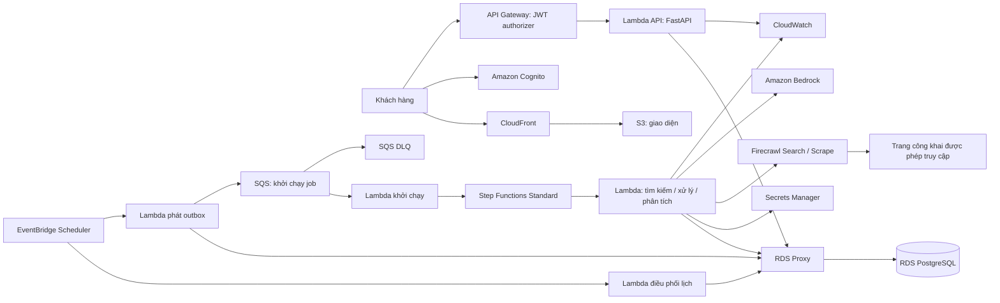

# Kiến trúc AWS — Brand Auto-Tracking

## 1. Mục tiêu và trạng thái

Tài liệu đề xuất kiến trúc triển khai thực tế trên AWS để đáp ứng [SRS](software_requirements_specification.md). Các dịch vụ và thông số là lựa chọn thiết kế ban đầu, chưa được triển khai hay kiểm chứng chi phí. Các quy tắc nghiệp vụ đề xuất ở mục 10 SRS vẫn cần nhóm xác nhận.

**Ràng buộc:** tìm kiếm và thu thập nội dung thông qua Firecrawl Search và Scrape; hệ thống không gọi trực tiếp API của TikTok, Facebook, Threads hoặc Reddit. Firecrawl Cloud là dịch vụ ngoài AWS; các thành phần còn lại ưu tiên dịch vụ AWS.

**Đường demo giả lập:** Trên môi trường riêng, EventBridge có thể kích hoạt bộ lập lịch demo hữu hạn → outbox/SQS → Lambda worker dùng provider giả → RDS. Nội dung lưu nguồn `demo`, không phải kết quả Firecrawl; công tắc mặc định tắt. Đây là nhánh bổ sung phục vụ trình diễn, chưa được triển khai hoặc kiểm thử AWS; xem [kế hoạch demo](demo_presentation.md).

**Quyết định 27/11 (mã và template đã có, chưa triển khai trên AWS):** Môi trường demo chuyển API từ API Gateway + Lambda sang **EC2 trong Auto Scaling Group sau Application Load Balancer**:
- CloudFront chuyển `/api/*` đến ALB.
- Auto Scaling Group gồm 1–3 máy, thường chạy 2, ở hai AZ.
- Worker vẫn chạy trên Lambda qua SQS.
- Cảnh báo nhãn hàng gửi email qua SNS đến một địa chỉ cố định dành cho demo.

Bảng và sơ đồ bên dưới vẫn mô tả phương án Lambda cũ cho đến khi bản EC2 được triển khai và kiểm chứng. Chi tiết, chi phí và tiêu chí xem [kế hoạch cập nhật demo](development-process/demo_update_plan.md#4b-chuyển-api-sang-ec2-với-auto-scaling-và-load-balancer).

## 2. Công nghệ và dịch vụ đề xuất

| Thành phần | Công nghệ / dịch vụ | Vai trò |
|---|---|---|
| Giao diện | React, TypeScript, Amazon S3, Amazon CloudFront | Xây dựng và phân phối ứng dụng web tĩnh qua HTTPS. |
| Tài khoản | Amazon Cognito User Pools | Đăng ký, đăng nhập, quản lý người dùng và cấp token. |
| API | Amazon API Gateway HTTP API, AWS Lambda, Python/FastAPI | Cung cấp API, kiểm tra JWT và xử lý nghiệp vụ. FastAPI chạy qua adapter ASGI cho Lambda. |
| Lưu trữ nghiệp vụ | Amazon RDS for PostgreSQL | Nhãn hàng, cấu hình, phiên, nội dung, cảnh báo và kết quả phân tích. |
| Kết nối CSDL | Amazon RDS Proxy | Giới hạn và chia sẻ kết nối từ Lambda tới RDS. |
| Lịch | Amazon EventBridge Scheduler | Kích hoạt Lambda điều phối theo lịch kiểm tra định kỳ. |
| Hàng đợi | Amazon SQS và dead-letter queue (DLQ) | Tách tác vụ tracking và AI khỏi API, xử lý lại khi lỗi. |
| Điều phối | AWS Step Functions Standard | Điều phối và quan sát các bước trong phiên tracking, gom kết quả và xử lý lỗi một phần. |
| Tác vụ nền | AWS Lambda | Search/Scrape Firecrawl, chuẩn hóa, phân tích cảm xúc, tính cảnh báo, gọi AI. |
| AI | Amazon Bedrock, tùy chọn Bedrock Guardrails | Mô hình ngôn ngữ để phân loại cảm xúc và phân tích có dẫn chứng. |
| Bảo mật | IAM, AWS Secrets Manager, AWS KMS | Phân quyền dịch vụ, lưu khóa Firecrawl, quản lý khóa mã hóa. |
| Vận hành | Amazon CloudWatch, AWS CloudTrail, AWS Budgets | Log, chỉ số, cảnh báo vận hành, lịch sử thao tác AWS và theo dõi ngân sách. |
| Hạ tầng | AWS CloudFormation hoặc AWS SAM | Khai báo tài nguyên, triển khai lặp lại và quản lý môi trường. |

Phương án Lambda không cần tự vận hành Redis, Celery, máy ảo hay Kubernetes. Theo quyết định 27/11, môi trường demo sẽ thêm máy ảo EC2 cho API như đã nêu ở mục 1. Các thành phần AWS trên là mục tiêu thiết kế; sử dụng nhiều dịch vụ managed có thể tăng chi phí và độ phức tạp.

## 3. Sơ đồ kiến trúc

API và điều phối ghi outbox trong cùng giao dịch PostgreSQL. Scheduler kích hoạt Lambda phát outbox; SQS đệm yêu cầu khởi chạy và Step Functions điều phối các bước của một job. Cấu hình thực tế cho phép CloudFront hoặc giao diện gọi API Gateway theo domain/CORS đã định.

## 4. Ánh xạ SRS

| Yêu cầu SRS | Giải pháp |
|---|---|
| FR-01–02 | Cognito xử lý tài khoản, API Gateway kiểm tra JWT, Lambda kiểm tra quyền sở hữu bằng Cognito `sub` trên mọi truy vấn và tác vụ. |
| FR-03–09 | React và Lambda API quản lý nhãn hàng, từ khóa, nguồn, lịch, giới hạn; RDS lưu dữ liệu. |
| FR-10–16 | Scheduler kích hoạt bộ điều phối; SQS và Lambda dùng Firecrawl Search/Scrape, lưu phiên và snapshot trong RDS. |
| FR-17–21 | Lambda API truy vấn RDS theo chủ sở hữu; React hiển thị theo phiên hoặc tổng hợp, gồm trường không khả dụng. |
| FR-22–26 | Lambda gọi Bedrock phân loại, sau đó đánh giá cảnh báo và lưu thông báo trong RDS; giao diện đọc qua API. |
| FR-27–30 | API tạo job, SQS/Lambda gọi Bedrock và lưu kết quả có dẫn chứng; người dùng xem trạng thái và kết quả. |
| NFR-01–08 | AWS managed services, IAM, Cognito, TLS, KMS, CloudWatch, backup RDS và kiểm thử. Chỉ tiêu định lượng còn chờ chốt và đo. |

Đối với FR-27–30, mã thử nghiệm hiện gọi model đồng bộ trong API Lambda sau khi ghi yêu cầu `running`; chưa có SQS cho phân tích. Yêu cầu quá hai phút được đánh dấu lỗi khi đọc lịch sử, thử lại cùng khóa hoặc worker quét; kết quả đến muộn bị từ chối, không tự gọi lại model. Mỗi yêu cầu chọn tối đa 30 nội dung theo thời gian thu thập, xác minh ID dẫn chứng thuộc mẫu và lưu kết quả; việc ID hợp lệ không xác nhận nội dung suy luận đúng. Thiết kế workflow trong bảng vẫn là phương án cần hoàn thiện. [S7](development-process/s7_ai_analysis.md).

## 5. Tài khoản và cấu hình

Cognito User Pools hỗ trợ đăng ký, đăng nhập và xác minh email theo cấu hình. Giao diện lấy token qua luồng OAuth 2.0 authorization code với PKCE; API Gateway JWT authorizer xác minh chữ ký, issuer, audience/client_id và yêu cầu scope cho route bảo vệ. Lambda kiểm tra thêm `token_use=access`, `sub` và quyền sở hữu ở tầng nghiệp vụ, không tin ID từ client. Chỉ cấu hình route công khai cho chức năng cần thiết. Việc khôi phục tài khoản và chính sách chia sẻ cần nhóm xác nhận.

Mỗi nhãn hàng thuộc một tài khoản. RDS lưu từ khóa, nguồn, tần suất, múi giờ, giới hạn bài và trạng thái. Lưu thời điểm chạy tiếp theo bằng UTC, hiển thị theo múi giờ của khách hàng. Thay đổi cấu hình chỉ áp dụng cho phiên mới; tạm dừng ngăn phiên mới và phiên đang chạy tiếp tục. Theo lựa chọn của người dùng, xóa nhãn hàng sau xác nhận xóa dữ liệu liên quan trong database; API từ chối khi tác vụ đang hoạt động. Snapshot/backup có thể còn dữ liệu sau thao tác; chính sách lưu và xử lý bản sao cần chốt trước vận hành thực tế.

## 6. Lịch và xử lý tracking

**Triển khai thử nghiệm hiện tại:** Template phát triển có thể bật một EventBridge rule gọi Lambda mỗi phút. Lambda dùng PostgreSQL để khóa nhãn hàng, xếp phiên đến hạn và nhận tối đa một phiên chờ. Mã hiện có thêm chế độ outbox/SQS/DLQ tùy chọn với kiểm thử giả lập, chưa kiểm thử triển khai AWS; chưa có Step Functions hay lease như phương án dưới đây. Lịch bị lỡ được gộp thành một phiên khi bộ điều phối hoạt động trở lại; nếu đang có phiên hoạt động, lịch đến hạn được ghi bỏ qua. Xem giới hạn và kết quả tại [S5](development-process/s5_tracking.md). Các bước dưới đây vẫn là kiến trúc đề xuất, không phải mô tả các thành phần đã triển khai.

Template cũng khai báo log group, metric filter và alarm cho lỗi thực thi Lambda hoặc phiên thất bại/một phần/quá hạn, alarm thiếu invocation khi bật lịch, alarm DLQ và tùy chọn gắn SNS topic. Một stack CloudWatch tạm dùng cùng bộ lọc đã chuyển alarm sang `ALARM` với log giả; đường CloudWatch → SNS → SQS cũng đã thử bằng trạng thái alarm đặt thủ công. Template đầy đủ, alarm thiếu invocation/DLQ và kênh người dùng chưa được kiểm thử đầu cuối. [Hướng dẫn hạ tầng](../infrastructure/README.md).

1. EventBridge Scheduler kích hoạt Lambda điều phối theo chu kỳ cố định đề xuất mỗi phút. Lambda đọc các lịch đến hạn trong RDS. Giao dịch, khóa dòng và ràng buộc duy nhất bảo đảm không có hai phiên hoạt động cho một nhãn hàng. Nếu lịch đến khi phiên trước còn chạy, ghi nhận bỏ qua theo SRS.
2. Trong cùng giao dịch PostgreSQL, tạo phiên, bản chụp cấu hình, các lượt theo từng cặp nguồn/từ khóa và sự kiện trong bảng **outbox**. Lambda phát outbox được Scheduler kích hoạt định kỳ, gửi sự kiện sang SQS rồi đánh dấu đã phát. Nếu gửi thành công nhưng chưa đánh dấu, sự kiện có thể gửi lại.
3. SQS đệm yêu cầu khởi chạy; Lambda nhận thông điệp và khởi chạy Step Functions Standard bằng định danh job ổn định. Lambda và các bước workflow xử lý idempotent dựa trên trạng thái và ràng buộc DB; SQS standard có thể gửi lại hoặc đảo thứ tự. Dùng lease có chủ sở hữu và generation/fencing: chỉ lượt còn lease hợp lệ được cập nhật kết quả. Không hứa exactly-once đối với lời gọi Firecrawl/Bedrock; retry vẫn có thể phát sinh chi phí. Lưu checkpoint từng bước và áp dụng hạn mức chi phí.
4. Với mỗi cặp nguồn/từ khóa, worker gọi Firecrawl Search, ví dụ truy vấn `site:reddit.com "gà rán ABC"`, lọc miền và URL không hợp lệ rồi chọn tối đa N kết quả theo SRS. Thứ tự Search là cách chọn bài nổi bật đề xuất, không khẳng định tương đương tương tác cao nhất.
5. Worker gọi Firecrawl Scrape cho các URL được chọn, chuẩn hóa dữ liệu và lưu bài, bình luận, link, thời gian, react, số bình luận khi nguồn cung cấp. Không có dữ liệu được lưu là null/không khả dụng, không suy diễn thành 0.
6. Mỗi lượt và phiên lưu trạng thái, số kết quả, lỗi đã loại bỏ bí mật; phân biệt thành công rỗng, thành công một phần và thất bại. Lỗi tạm thời được retry có backoff; lỗi quyền truy cập/đầu vào không retry vô hạn. Phân rã công việc thành lượt nhỏ đủ thời gian Lambda; nếu một lượt vượt giới hạn thực thi Lambda, chia nhỏ hoặc chuyển worker đó sang ECS Fargate sau khi đánh giá chi phí.

Step Functions dùng Inline Map với giới hạn song song để chạy các lượt search/scrape và phân loại, sau đó tổng hợp kết quả và đánh giá cảnh báo. Mỗi nhánh ghi thành công hoặc thất bại có cấu trúc, dùng Retry/Catch và timeout; việc gom chỉ hoàn tất sau khi tất cả nhánh đã đến trạng thái cuối. Không chạy cảnh báo khi nhánh còn chờ. Quá thời hạn, tác vụ đối soát đánh dấu thiếu dữ liệu/phiên lỗi hoặc một phần; finalizer idempotent và fencing ngăn kết quả đến muộn thay đổi phiên đã chốt. RDS là nguồn chân lý, workflow lưu ID thay vì payload nội dung lớn.

Thứ tự chốt là: hoàn tất và chốt trạng thái thu thập của phiên → đợi các tác vụ phân loại đến trạng thái cuối hoặc timeout → đánh giá cảnh báo với độ bao phủ đủ → chốt workflow. Với job gửi lại, Lambda khởi chạy đối chiếu job và execution đã có; `StartExecution` Standard chỉ idempotent cùng tên và input khi execution còn chạy. Nếu nhận `ExecutionAlreadyExists`, xác minh execution tương ứng và coi yêu cầu đã xử lý, không tạo execution mới hoặc retry vô hạn; nếu không đối chiếu được thì ghi lỗi để kiểm tra.

SQS cấu hình batch size 1 hoặc `ReportBatchItemFailures`; visibility timeout tối thiểu 6 lần Lambda timeout cộng batching window theo hướng dẫn AWS, maxReceiveCount và redrive DLQ có kiểm soát. Scheduler cần retry/DLQ cho lỗi chuyển sự kiện và cấu hình xử lý lỗi riêng khi Lambda chạy bất đồng bộ; chuyển thành công không chứng minh tác vụ đã hoàn tất. Quét định kỳ outbox và phiên quá hạn để phục hồi các trường hợp này.

Dùng định danh nguồn hoặc URL chuẩn hóa khi đủ tin cậy; lưu liên kết một nội dung với nhiều lượt/phiên và snapshot tương tác theo thời điểm. Nếu thiếu định danh ổn định, đánh dấu khả năng trùng thay vì khẳng định khử trùng hoàn toàn.

### Giới hạn và kiểm chứng Firecrawl

Firecrawl Search phụ thuộc nội dung được lập chỉ mục; Scrape không bảo đảm lấy được bài, bình luận, thời gian hay số liệu động, nhất là nội dung cần đăng nhập hoặc bị hạn chế. Không thiết kế vượt qua các hạn chế truy cập; cần kiểm tra quyền, điều kiện nguồn và chính sách liên quan trước khi bật.

Thử nghiệm ngày 15/11/2026: Firecrawl Scrape qua provider `scrapecreators` trả dữ liệu TikTok có cấu trúc cho tìm video và bình luận; có thể tự sắp xếp theo lượt thích trong tập kết quả đã thu được, không xem đây là toàn bộ nền tảng. Response rút gọn của bình luận không có ID riêng trong mẫu, còn response đầy đủ có `cid`. Đây là kết quả kiểm chứng kỹ thuật, chưa xác nhận quyền dùng định kỳ hay chi phí sản phẩm; chi tiết, hạn chế và chi phí thử tại [giai đoạn 2](development-process/s2_firecrawl.md).

Trước khi cam kết hỗ trợ mỗi nền tảng, thử thực tế với bộ từ khóa mẫu và ghi ngày thử, số URL hợp lệ, tỷ lệ scrape thành công, trường/bình luận/react lấy được, lỗi và chi phí. Cần kiểm chứng ít nhất một nguồn lấy được bài và bình luận trước khi cam kết FR-13 và cảnh báo bình luận. Nếu không đạt, báo trường/nguồn chưa hỗ trợ và thống nhất điều chỉnh phạm vi SRS. Fixture chỉ dùng kiểm thử hoặc demo khi ghi rõ là dữ liệu mẫu.

## 7. Dữ liệu

RDS PostgreSQL lưu tối thiểu:

- `users` liên kết Cognito `sub`, `brands`, `brand_keywords`, `brand_sources`, `tracking_configs`.
- `tracking_runs`, `tracking_attempts`, `outbox_events` lưu lịch sử, cấu hình chụp lại, trạng thái và công việc.
- `posts`, `comments`, `run_post_matches`, `run_comment_matches`, `engagement_snapshots` lưu nội dung, liên kết phiên và chỉ số theo thời điểm.
- `sentiment_results`, `alert_rules`, `alerts`, `analysis_jobs`, `analysis_results`, `analysis_evidence` lưu phân tích, quy tắc, cảnh báo và bằng chứng AI.

Ràng buộc unique theo nguồn/định danh khi khả dụng và theo quy tắc/loại/cửa sổ cảnh báo. Các bảng được kiểm tra quyền theo tài khoản. Bật mã hóa RDS, backup tự động, cấu hình thời hạn lưu phù hợp ngân sách và kiểm thử khôi phục; thời hạn lưu dữ liệu nghiệp vụ vẫn cần nhóm phê duyệt.

## 8. AI và cảnh báo

Lambda gọi mô hình qua Amazon Bedrock để phân loại cảm xúc thành tích cực, tiêu cực, trung lập hoặc không xác định; lưu phiên bản mô hình và trạng thái. Chọn mô hình và Region theo khả năng cung cấp, quyền truy cập, chi phí và kết quả thử nghiệm tiếng Việt. Không mặc định Amazon Comprehend hỗ trợ sentiment tiếng Việt: danh sách ngôn ngữ được hỗ trợ trong tài liệu AWS không nêu tiếng Việt. Đánh giá mô hình trên tập tiếng Việt được gán nhãn trước khi sử dụng kết quả làm căn cứ.

Bộ đánh giá chỉ chạy sau khi phiên kết thúc và các tác vụ phân loại hoàn tất hoặc hết thời gian chờ. Đếm bài và bình luận tiêu cực duy nhất theo thời gian thu thập đầu tiên, tách theo loại. Chỉ so sánh hai cửa sổ khi nguồn, từ khóa, giới hạn và độ bao phủ tương đương; nếu thiếu dữ liệu thì không coi là 0 và không tính tốc độ tăng. Công thức, trường hợp mẫu số 0 và chống lặp theo SRS mục 10.2; ngưỡng độ bao phủ cần xác nhận. Lưu cảnh báo trong RDS để xem trong ứng dụng. Amazon SNS/email là phương án mở rộng, chưa mặc định triển khai.

Mã thử nghiệm hiện dùng Lambda tùy chọn sau phiên hoặc API thủ công, chưa triển khai workflow Step Functions mô tả ở trên. Scheduler ghi thời điểm dự kiến, liên kết nội dung ghi thời điểm/hash quan sát và bộ đánh giá đọc ảnh chụp PostgreSQL nhất quán; ràng buộc duy nhất chống cảnh báo trùng. Quy tắc độ trễ, giới hạn bằng chứng và dữ liệu cũ thiếu thời điểm được mô tả tại SRS 10.2 và [S6](development-process/s6_sentiment_alerts.md). Phân loại còn có thể bị giới hạn lượt gọi hoặc lỗi và khi đó không đủ cơ sở để cảnh báo.

Khách hàng chọn nhãn hàng và thời gian để yêu cầu phân tích. Lambda truy vấn nội dung được phép, gắn ID nguồn và gửi dữ liệu tối thiểu đến Bedrock; đầu ra có nhận định, đề xuất và ID làm căn cứ. Backend xác minh ID thuộc tập đầu vào, loại hoặc gắn cờ nhận định không có căn cứ. Giao diện nêu số lượng, phạm vi, nguồn, bằng chứng và hạn chế. Nội dung nguồn là dữ liệu không tin cậy; không được cấp quyền điều khiển công cụ. Có thể cấu hình Bedrock Guardrails để hỗ trợ phát hiện prompt injection nhưng không xem đây là bảo vệ tuyệt đối. Thiếu dữ liệu, lỗi hoặc timeout phải thông báo rõ.

## 9. Mạng, bảo mật và vận hành

- Lambda API và worker kết nối RDS Proxy/RDS trong VPC private subnet; security group chỉ cho phép luồng cần thiết. Lambda trong VPC cần đường outbound tới Firecrawl qua NAT Gateway hoặc phương án egress được cấu hình; endpoint VPC cho AWS services nếu phù hợp. Tính chi phí NAT và truyền dữ liệu trước khi chọn.
- CloudFront phục vụ S3 private qua Origin Access Control; HTTPS dùng chứng chỉ phù hợp với domain. API Gateway xác thực JWT; cấu hình CORS theo domain giao diện.
- Secrets Manager lưu Firecrawl API key; IAM role cấp quyền tối thiểu từng Lambda. KMS mã hóa dữ liệu phù hợp; không ghi token và dữ liệu nhạy cảm vào CloudWatch logs.
- CloudWatch theo dõi lỗi Lambda, tuổi/độ sâu hàng đợi, DLQ, lỗi Firecrawl/Bedrock, phiên treo, kết nối RDS và chi phí ước tính; CloudTrail ghi thao tác quản trị AWS. Cấu hình retention log và báo động. AWS Budgets gửi cảnh báo ngân sách nhưng không bảo đảm chặn chi phí ngay lập tức.
- Triển khai bằng SAM/CloudFormation, môi trường dev và demo tách cấu hình. Dùng migration cho RDS, giới hạn đồng thời Lambda và tốc độ gọi Firecrawl/Bedrock. Region, domain, bảo trì, thời hạn backup, RPO/RTO và quy trình phục hồi cần chốt.

## 10. Chi phí và phương án giảm quy mô

Các khoản đáng lưu ý: RDS và RDS Proxy chạy liên tục, NAT Gateway, Lambda, SQS, số lần chuyển trạng thái Step Functions, CloudWatch, lưu trữ/backup, Bedrock theo mức dùng và Firecrawl theo gói sử dụng. Chọn Region sau khi kiểm tra dịch vụ/mô hình và giá thực tế; dùng AWS Pricing Calculator và báo giá Firecrawl với số lượt/khối lượng dự kiến. Không giả định các dịch vụ đều miễn phí.

Phương án tiết kiệm cho demo: cân nhắc bỏ RDS Proxy khi tải thấp và giới hạn kết nối Lambda; đánh giá egress thay NAT Gateway theo thiết kế mạng phù hợp; chỉ bật tài nguyên có chi phí cố định khi cần, sau khi xác nhận bảo toàn dữ liệu. Thay đổi phải được đo và kiểm thử, không thay thế backup hay kiểm soát truy cập.

## 11. Kế hoạch kiểm chứng

1. Kiểm thử phân quyền hai tài khoản qua API và worker, bao gồm truy cập ID của tài khoản khác.
2. Dùng fixture và adapter Firecrawl giả để kiểm thử lịch, outbox, gửi lặp SQS, idempotency, lease, DLQ, trạng thái một phần, dedup và snapshot.
3. Kiểm thử cảnh báo 10→15, 10→14, 0→15, thiếu dữ liệu và thay đổi phạm vi theo SRS; xác nhận không phát cảnh báo sai hay lặp.
4. Kiểm thử AI với ID bằng chứng sai, prompt injection trong nội dung nguồn, tập rỗng, timeout và lỗi; đánh giá chất lượng cảm xúc tiếng Việt.
5. Thử Firecrawl thật trên từng nguồn theo mục 6; không suy ra hỗ trợ thật từ fixture.
6. Triển khai AWS, chạy luồng đăng ký → cấu hình → tracking → xem kết quả → cảnh báo → AI; kiểm thử backup/khôi phục, đo chi phí và thời gian theo tải đã thống nhất.

## 12. Quyết định còn mở

- Region AWS, tài khoản và ngân sách, mô hình Bedrock có quyền dùng, nguồn demo Firecrawl và khả năng lấy bình luận.
- Quy tắc xác thực email/khôi phục tài khoản, xóa dữ liệu, thời hạn lưu, số bình luận, múi giờ, lịch bỏ lỡ và ngưỡng độ bao phủ.
- Chỉ tiêu hiệu năng, chất lượng mô hình, thời gian phản hồi, tính sẵn sàng, RPO/RTO và các kênh cảnh báo ngoài ứng dụng.

## 13. Dịch vụ AWS mở rộng có giá trị thực tế

- **Amazon Bedrock Knowledge Bases:** khi dữ liệu lớn và cần hỏi đáp ngữ nghĩa qua nhiều phiên, cân nhắc embedding và truy xuất kèm dẫn chứng. Bản đầu dùng truy vấn RDS theo tài khoản và ID dẫn chứng để đơn giản. Nếu triển khai Knowledge Bases, bắt buộc lọc tài khoản, nhãn hàng, thời gian ở server, đồng bộ xóa và kiểm thử cô lập dữ liệu; tính thêm chi phí embedding/vector. Guardrails không tự bảo vệ toàn bộ nội dung truy xuất.
- **AWS AppConfig:** tùy chọn bật/tắt nhanh adapter của nền tảng bị lỗi và áp dụng feature flag theo môi trường mà không triển khai lại. Cần kiểm thử cache, thời gian áp dụng và chi phí; với MVP có thể lưu trạng thái nguồn trong RDS.
- **Amazon SNS:** mở rộng gửi email cảnh báo khi nhóm chốt kênh, quy tắc chống lặp và xử lý gửi lỗi. Thông báo trong ứng dụng vẫn lưu RDS làm nguồn lịch sử.
- **AWS Step Functions:** đã chọn cho luồng có nhiều nhánh và cần fan-in; dùng Inline Map giới hạn đồng thời phù hợp quy mô MVP, chưa cần Distributed Map. Giá state transition và độ phức tạp cần đo so với SQS/Lambda trực tiếp.

Những dịch vụ mở rộng không phải yêu cầu bắt buộc hay bằng chứng hệ thống đã triển khai; lựa chọn dựa trên nhu cầu và ngân sách, không thêm dịch vụ chỉ để tăng số lượng.

## 14. Tham khảo

- [Firecrawl Search](https://docs.firecrawl.dev/features/search), [Firecrawl Scrape](https://docs.firecrawl.dev/features/scrape), [mã nguồn Firecrawl](https://github.com/firecrawl/firecrawl).
- [EventBridge Scheduler và Step Functions](https://docs.aws.amazon.com/step-functions/latest/dg/using-eventbridge-scheduler.html), [Scheduler targets](https://docs.aws.amazon.com/scheduler/latest/UserGuide/managing-targets-templated.html).
- [Amazon Comprehend: ngôn ngữ hỗ trợ](https://docs.aws.amazon.com/comprehend/latest/dg/supported-languages.html).
- [Bedrock Guardrails: prompt attacks](https://docs.aws.amazon.com/bedrock/latest/userguide/guardrails-prompt-attack.html).
- [Step Functions: xử lý lỗi](https://docs.aws.amazon.com/step-functions/latest/dg/concepts-error-handling.html), [Inline Map](https://docs.aws.amazon.com/step-functions/latest/dg/state-map-inline.html), [SQS với Lambda](https://docs.aws.amazon.com/lambda/latest/dg/services-sqs-configure.html).
- [API Gateway JWT authorizer](https://docs.aws.amazon.com/apigateway/latest/developerguide/http-api-jwt-authorizer.html), [Bedrock structured outputs](https://docs.aws.amazon.com/bedrock/latest/userguide/structured-output.html), [Bedrock Knowledge Bases](https://docs.aws.amazon.com/bedrock/latest/userguide/knowledge-base.html), [AppConfig Lambda extension](https://docs.aws.amazon.com/appconfig/latest/userguide/appconfig-integration-lambda-extensions.html).

