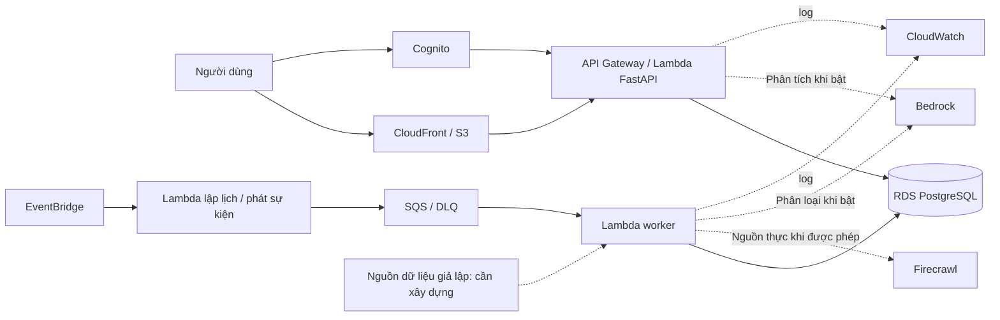

# Kế hoạch xây dựng và trình diễn demo

**Cập nhật:** 26/11/2026 · **Trạng thái:** đã diễn tập đầy đủ một lượt trên AWS; môi trường thử đang được dọn, cần dựng lại và diễn tập trước buổi bảo vệ. AI có lần thất bại nên đã chuẩn bị tư liệu dự phòng.

**27/11:** Lượt review cũ đã dừng khi chuyển hướng theo yêu cầu; môi trường đang được dọn. Theo dõi trạng thái và kết quả tại [S8](development-process/s8_aws_delivery.md).

**Kịch bản mới đã chốt 27/11:** gồm một dòng dữ liệu giả theo phút, cảnh báo theo tỷ lệ gửi qua email, AI, rồi đợt tích cực; API chạy trên EC2 với ALB và Auto Scaling.
- Mã đã xong và kiểm thử cục bộ đạt, kể cả với Chrome.
- **Chưa dựng và diễn tập trên AWS.**

Xem [kế hoạch cập nhật demo](development-process/demo_update_plan.md). Kịch bản bên dưới vẫn là bản đã diễn tập ngày 26/11 và được dùng cho đến khi bản mới được kiểm chứng trên AWS.

**Điều chỉnh theo yêu cầu 27/11:** Hướng đơn giản là phát dữ liệu giả mỗi 1–3 phút. Mã đã bổ sung khoảng cách này cho lịch giả lập, chưa triển khai/kiểm thử AWS. Cảnh báo hiện vẫn dùng hai cửa sổ theo ngày và lịch sử dựng sẵn; chưa thể khẳng định hai đợt theo phút trực tiếp tạo cảnh báo. Cần hoàn thiện so sánh theo phút có bằng chứng, giao diện và diễn tập trước khi thay thế kịch bản cũ.

Sau mỗi phần xây dựng hoặc kiểm thử demo, cập nhật ngay trạng thái, bằng chứng, giới hạn và bước tiếp theo tại đây và tài liệu giai đoạn liên quan; cập nhật [hướng dẫn thuyết trình](demo_speaking_guide.md) khi thao tác thay đổi. Chỉ ghi kết quả đã kiểm chứng.

## Mục tiêu và phạm vi

Demo là ưu tiên chính của dự án: giải thích được kiến trúc cloud và chứng minh một người dùng có thể theo dõi thương hiệu, quan sát dữ liệu mới, cảnh báo và phân tích. Buổi trình bày có hai phần: **kiến trúc** và **sử dụng hệ thống thực tế**, trong đó mở AWS Console để đối chiếu các dịch vụ với thao tác vừa thực hiện. Thời lượng gợi ý 15–20 phút, điều chỉnh theo yêu cầu giảng viên.

Dữ liệu của tình huống là **giả lập**, được đánh dấu rõ trên giao diện và khi trình bày. Việc sinh dữ liệu không chứng minh Firecrawl đang thu thập hay phản ánh ý kiến khách hàng thật. Firecrawl là một nguồn thực riêng đã từng thử; không mở rộng thu thập TikTok khi chưa làm rõ điều kiện sử dụng. Kết quả AI là tham khảo, không tự thực hiện quyết định kinh doanh.

## Tình huống xuyên suốt

Chuỗi đồ uống giả định **Mây Tea** ra mắt sản phẩm mới. Ban đầu các bài và bình luận phần lớn trung lập hoặc tích cực; sau đó xuất hiện nhiều phản ánh về vị ngọt và giao hàng. Người quản lý đăng ký tài khoản, tạo thương hiệu, cấu hình từ khóa và theo dõi các đợt dữ liệu phát sinh. Khi số nội dung tiêu cực vượt ngưỡng, hệ thống hiển thị cảnh báo; người quản lý xem phân tích và dẫn chứng để đề xuất xử lý.

Chuẩn bị hai cửa sổ so sánh hợp lệ, cùng phạm vi và đủ kết quả phân loại: cửa sổ trước có 10 nội dung tiêu cực, cửa sổ sau có 15; ngưỡng tăng 50%. Con số này là mục tiêu của kịch bản, chỉ trình bày là kết quả thực tế sau khi chạy và kiểm tra. Thiết kế thời gian, nội dung và số lượng các đợt phải phù hợp quy tắc hiện hành, không làm sai lệch dữ liệu thật. Chuẩn bị thêm nội dung tích cực và trung lập để xu hướng dễ hiểu.

## Phần 1 — Giải thích kiến trúc

**Mục tiêu:** người xem hiểu dữ liệu đi qua đâu và tại sao dùng từng dịch vụ. Dùng một sơ đồ trên slide, không đi sâu cấu hình ngay đầu buổi.

Sơ đồ biểu diễn hướng demo dự kiến: vị trí kết nối nguồn giả và cách kích hoạt chính xác cần chốt khi triển khai, không khẳng định đã có. CloudFront/S3 phục vụ giao diện; Cognito xác thực; API Gateway/Lambda xử lý yêu cầu; RDS lưu dữ liệu; EventBridge, SQS và worker điều phối xử lý nền; Bedrock hỗ trợ phân loại và phân tích; CloudWatch quan sát vận hành. Firecrawl là dịch vụ ngoài AWS. Secrets Manager quản lý bí mật, CloudFormation mô tả hạ tầng; chỉ trình bày cấu hình thực sự được triển khai và kiểm chứng.

## Phần 2 — Trình diễn hệ thống và AWS

| Bước | Thao tác và điều cần thấy | Đối chiếu AWS và lời giải thích |
|---|---|---|
| 1. Tạo tài khoản | Đăng ký tài khoản demo mới, hoàn tất bước xác nhận theo cấu hình demo, rồi đăng nhập. | Cognito: user pool và trạng thái tài khoản. Nếu email giả được tự xác nhận, nói rõ đây là giả lập, không chứng minh gửi/nhận mã email thật. Không chiếu mật khẩu hoặc mã. |
| 2. Đăng ký theo dõi | Tạo Mây Tea, nhập từ khóa, cấu hình theo dõi và ngưỡng; lưu rồi tải lại để chứng minh dữ liệu được lưu. | API Gateway/Lambda nhận yêu cầu, RDS lưu cấu hình. Chỉ vào tài nguyên của stack demo; không lộ nội dung nhạy cảm. |
| 3. Dữ liệu xuất hiện liên tục | Bật bộ sinh giả lập giới hạn trước; quan sát ít nhất hai đợt có dấu thời gian, phiên và nội dung mới trên giao diện. Giải thích nguồn và nhịp sinh. | Đối chiếu thời điểm và ID phiên với EventBridge, SQS và log worker trên CloudWatch. Metric SQS có thể trễ hoặc bằng 0 nếu xử lý nhanh; log và trạng thái phiên là bằng chứng bổ sung. |
| 4. Cảnh báo | Mở hai cửa sổ, số liệu và ngưỡng; chạy hoặc chờ đánh giá theo cấu hình đã kiểm chứng. Xem cảnh báo và đánh giá lại để kiểm tra không lặp. | Chỉ ra worker/tác vụ đánh giá và dữ liệu đã lưu nếu đã triển khai. Không nói CloudWatch alarm là cảnh báo kinh doanh trong ứng dụng. |
| 5. Phân tích AI | Chọn khoảng thời gian, chạy phân tích, mở chủ đề, đề xuất và dẫn chứng thuộc dữ liệu giả. | Giải thích vai trò Bedrock và chỉ ra bằng chứng invocation/log hoặc metric khả dụng đã kiểm thử; không coi câu trả lời AI là sự thật được xác minh. |
| 6. Quan sát cloud | Mở CloudFormation để xác định đúng stack, sau đó xem nhanh CloudWatch, Lambda, SQS và RDS; đối chiếu thời gian/ID với thao tác vừa chạy. | Chỉ cho thấy trạng thái, log và metric thực có; metric trễ, hàng đợi rỗng hoặc một tài nguyên tồn tại không tự chứng minh toàn bộ luồng. Không mở giá trị secret hay dữ liệu cá nhân. |

**Cách trình bày:** Người thuyết trình dẫn câu chuyện; một người vận hành thao tác và mở sẵn các tab AWS theo thứ tự. Trong khi chờ xử lý có thể giải thích sơ đồ; sau mỗi bước trở lại giao diện để nối hạ tầng với kết quả người dùng thấy. Ưu tiên ít dịch vụ nhưng có bằng chứng rõ ràng.

## Yêu cầu xây dựng luồng giả lập

**Tiến độ 26/11:** [demo_stream.py](../backend/app/demo_stream.py) tạo các đợt giả có giới hạn và đưa qua tracking; nội dung được đánh dấu, bài lưu nguồn `demo`, URL `.invalid` không hiển thị thành liên kết và giao diện có nhãn/bộ lọc giả lập. [demo_scheduler.py](../backend/app/demo_scheduler.py) xếp hữu hạn các đợt vào outbox; Lambda chọn provider giả cho đúng nhãn hàng và phiên demo, công tắc mặc định tắt. PostgreSQL riêng và SQS giả đã kiểm tra lưu hai đợt, xử lý hàng đợi và giới hạn; frontend build đạt, template AWS qua `validate-template`. Chưa thử trình duyệt, luồng SQS/EventBridge trên AWS, phân loại, cảnh báo hay AI với bộ sinh này. Không gọi Firecrawl. Chi tiết bật/tắt và các điều kiện xem [hướng dẫn hạ tầng](../infrastructure/README.md).

**Bổ sung 26/11 — lịch sử cảnh báo:** [demo_history.py](../backend/app/demo_history.py) tạo hai phiên lịch sử giả, 10 và 15 bình luận tiêu cực với **nhãn gán sẵn**, không gọi Bedrock. PostgreSQL và giao diện AWS đã thử đánh giá; chạy lại không tạo bản sao, nạp lại cùng phiên không nhân đôi. Nhãn dựng sẵn phục vụ biểu diễn quy tắc, không chứng minh chất lượng phân loại. Luồng sinh liên tục không tự tạo đủ lịch sử hai ngày.

**Bổ sung 26/11 — trình duyệt:** [demo-browser.cjs](../frontend/tests/demo-browser.cjs) đã chạy Chrome với frontend, API và PostgreSQL riêng, xác thực giả: tạo thương hiệu, phát hai đợt, thấy nguồn giả, không mở liên kết giả; nạp lịch sử giả, lưu quy tắc, đánh giá 10→15 và đánh giá lại không lặp. Chưa thử Cognito, AWS hay AI trong lượt này.

**Bổ sung 26/11 — AWS đang thử:** Chrome/Cognito/API tạo thương hiệu thử; EventBridge → outbox/SQS → Lambda xử lý thành công hai phiên giả; Lambda lịch sử nạp 10→15 và giao diện đánh giá được cảnh báo. Một yêu cầu Bedrock trả `failed`; lượt thử lại với thương hiệu và dữ liệu giả mới trả phân tích thành công có dẫn chứng. Chưa xác định nguyên nhân lượt lỗi; một thành công không chứng minh chất lượng hay độ ổn định. Stack thử đang được xử lý/dọn, xem [S8](development-process/s8_aws_delivery.md).

**Công cụ vận hành:** [demo_control.py](../scripts/demo_control.py) chuẩn bị lịch sử rồi bật lịch, và có lệnh dừng; frontend tùy chọn hiển thị mã nhãn hàng khi build với `VITE_DEMO_TOOLS=true`. Đã thử start/stop trong câu chuyện AWS; các cập nhật stack cần thời gian chờ. Hướng dẫn lệnh tại [hạ tầng](../infrastructure/README.md).

**Đăng ký demo:** [cognito-demo.yaml](../infrastructure/cognito-demo.yaml) tạo pool riêng chỉ cho tự đăng ký địa chỉ `@example.invalid`, xác nhận/xác minh giả lập không gửi email. Chrome đã thử đăng ký và tạo nhãn hàng trong câu chuyện AWS. Pool này không dùng cho người dùng thật và không chứng minh xác minh email thực.

**Câu chuyện AWS 26/11:** [kiểm thử trình duyệt](../frontend/tests/aws-demo-signup.cjs) đã hoàn tất trên cùng tài khoản: đăng ký giả lập, tạo thương hiệu, vận hành bộ sinh, cảnh báo 10→15 và phân tích Bedrock thành công; log AWS ghi hai phiên sinh thành công. Frontend chạy cục bộ, lịch sử dùng nhãn dựng sẵn, một lượt AI trước đó thất bại; cần diễn tập hosting CloudFront và chuẩn bị phương án dự phòng. Chi tiết và dọn tài nguyên tại [S8](development-process/s8_aws_delivery.md).

**Hosting AWS 26/11:** Một lượt khác qua CloudFront/Cognito/API đã đăng ký giả lập, tạo nhãn hàng, bật hai đợt giả và đánh giá cảnh báo 10→15 thành công. Lượt hosting không gọi AI do đã hết hạn mức ngày; AI thành công ở lượt frontend cục bộ nêu trên. Phải giữ phương án dự phòng vì một lượt AI khác thất bại. Trạng thái dọn xem [S8](development-process/s8_aws_delivery.md).

**Điều chỉnh sau lượt AWS đầu:** Đợt sinh đầu ưu tiên lời khen, các đợt sau ưu tiên phản ánh tiêu cực; số thứ tự đợt được lưu trong cấu hình phiên. Kiểm thử PostgreSQL/SQS giả đã đạt hai đợt và giới hạn số đợt, cùng 121 kiểm thử backend trên database mới trước khi thêm kiểm thử riêng hai đợt. Kết quả AWS của bản điều chỉnh được ghi ngay bên dưới.

**Diễn tập đầy đủ qua CloudFront:** Bản điều chỉnh trên đã được thử trong một lượt với tài khoản demo mới: đăng ký giả lập, tạo thương hiệu, hai đợt có tỷ lệ lời khen 4/6 rồi 2/6, cảnh báo 10→15 và Bedrock có dẫn chứng đều đạt qua AWS. Hai yêu cầu AI ở lượt ngay trước đó thất bại; không suy ra độ ổn định hay chất lượng, cần có bản dự phòng. Không nhầm xu hướng theo phút với hai cửa sổ lịch sử gán nhãn. Tài nguyên thử đang xử lý/dọn; bằng chứng tại [S8](development-process/s8_aws_delivery.md).

**Dự phòng:** [Video luồng chính](development-process/evidence/demo-core-20261126.mp4) là bản ghi CloudFront ngày 26/11, không âm thanh, dùng dữ liệu giả và đã cắt khoảng chờ. Video cho thấy đăng ký, nội dung hai đợt và cảnh báo; không có AI hoặc AWS Console. Không trình bày video là lượt chạy trực tiếp.

[Ảnh dự phòng kết quả AI](development-process/evidence/demo-ai-20261126.png) chụp phân tích đã lưu từ dữ liệu giả qua CloudFront ngày 26/11. Bản thân ảnh không gắn nhãn giả; khi dùng phải trình bày kèm thông tin nguồn và giới hạn này. ID dẫn chứng hợp lệ không chứng minh nhận định đúng.

**Tiếp theo:** kiểm thử trình duyệt, triển khai môi trường AWS riêng và đối chiếu EventBridge/SQS/log; xây dựng dữ liệu hai cửa sổ, phân loại và cảnh báo; diễn tập toàn bộ. Các yêu cầu sau chưa được chứng minh:

- Có chế độ giả lập tách biệt và gắn nhãn nguồn giả xuyên suốt từ sinh, lưu đến hiển thị; không mạo nhận là Firecrawl hay bài mạng xã hội thật. Chỉ hoạt động trong môi trường demo, không ảnh hưởng dữ liệu người dùng khác.
- Sinh nhiều đợt bài và bình luận có ID ổn định, thời gian, nội dung và diễn biến có thể lặp lại; có giới hạn số đợt, tốc độ và thời gian chạy. Cho phép dừng và xác nhận đã dừng; chuẩn bị cách làm sạch hoặc đặt lại dữ liệu demo an toàn.
- Đi qua càng nhiều thành phần xử lý thực của hệ thống càng phù hợp, từ xếp việc đến lưu, phân loại, cảnh báo và hiển thị. Ghi rõ điểm vào, thành phần nào thực sự chạy, phần nào được giả lập; không nạp thẳng kết quả cuối rồi mô tả như đã xử lý trực tiếp.
- Kịch bản 10→15 phải tạo đủ bằng chứng về hai cửa sổ, phạm vi và nhãn theo quy tắc hiện hành. Nếu dùng nhãn dựng sẵn để ổn định, phân biệt với phân loại Bedrock thật; nếu dùng Bedrock, kiểm tra kết quả trước và có phương án khi mô hình trả khác.
- Giới hạn số lượt Bedrock và chi phí; không gọi Firecrawl trong chế độ giả lập trừ khi có bước thu thập thật riêng đã được phép. Không đưa thông tin cá nhân, khóa hoặc token vào dữ liệu và log.
- Viết hướng dẫn thao tác cụ thể sau khi triển khai, kiểm thử chạy lại, dừng, cách ly tài khoản, tránh trùng và xử lý lỗi. Lưu bằng chứng thời điểm, ID phiên, kết quả, log và chi phí; chỉ đánh dấu sẵn sàng khi diễn tập đầu cuối đạt.

## Chuẩn bị, diễn tập và vận hành

1. **Trước ngày demo:** chốt thời lượng, người thuyết trình và vận hành; kiểm kê AWS, ngân sách tối đa 30 USD toàn giai đoạn, số dư và quyền dịch vụ. Dựng môi trường demo riêng, cấu hình Cognito, frontend, API, database, worker, lịch và Bedrock theo hướng dẫn [hạ tầng](../infrastructure/README.md); kiểm tra bảo vệ dữ liệu và tác động tài nguyên trước khi thay đổi. AWS Budget chỉ cảnh báo, không tự chặn phí.
2. **Chuẩn bị tình huống:** cấu hình tài khoản/đăng ký, thương hiệu, nguồn giả, các đợt và hai cửa sổ; kiểm tra thời gian xử lý, dẫn chứng, ngưỡng, giới hạn lượt gọi và cách dừng. Chuẩn bị tài khoản dự phòng cùng ảnh/video có ngày, nguồn và nhãn dữ liệu. Không để thông tin đăng nhập trong tài liệu hoặc slide.
3. **Diễn tập đầu cuối:** chạy cả hai phần theo thời gian dự kiến; ghi màn hình, thời gian và ID phiên; đối chiếu giao diện với log của đúng stack. Thử đăng ký mới, tạo nhãn hàng, chạy nhiều đợt, cảnh báo, phân tích và dừng nguồn. Thử mất kết nối hoặc lỗi dịch vụ đã được chọn; ghi lỗi và sửa trước khi coi demo sẵn sàng.
4. **Trước giờ trình bày:** xác nhận đăng nhập SSO và tài khoản demo, HTTPS, API, lịch, worker, trạng thái nguồn giả, giới hạn và các tab console. Bật tài nguyên đủ sớm để khởi tạo; xác nhận đã có dữ liệu dự phòng. Chỉ bật dịch vụ cần dùng.
5. **Sau buổi demo:** dừng nguồn giả, lịch và mapping; kiểm tra worker hết xử lý. Theo hướng dẫn hạ tầng, tắt hoặc dọn tài nguyên demo phù hợp sau khi xác định dữ liệu cần giữ và bản sao; kiểm kê RDS, NAT, IP, snapshot, bucket, log và chi phí. Không xóa stack hoặc dữ liệu cũ khi chưa xác định tác động.

## Phương án dự phòng và giới hạn

- Nếu đăng ký hoặc xác thực trực tiếp lỗi, đăng nhập bằng tài khoản demo đã chuẩn bị; nói rõ bước nào dùng bản ghi và bước nào đang chạy thật.
- Nếu bộ sinh, AWS hoặc mạng chậm, chuyển sang video/lần chạy đã lưu có thời gian và ID; không trình bày bản ghi là kết quả trực tiếp. Nếu Bedrock lỗi, mở kết quả phân tích đã lưu và giải thích dịch vụ chưa phản hồi trong lượt này.
- Nếu cảnh báo không đúng, mở bằng chứng hai cửa sổ và kết quả đã kiểm chứng; không tự sửa số liệu trước khán giả để tạo kết quả mong muốn.
- Đăng ký bằng email giả tự xác nhận không chứng minh xác minh email thật. Dữ liệu giả và một tình huống được dựng không chứng minh độ bao phủ nguồn, chất lượng mô hình hay vận hành production.

## Trạng thái và tiêu chí sẵn sàng

Đã từng thử trên AWS: đăng nhập và tạo nhãn hàng qua hosting; tracking thật qua SQS/Firecrawl; cảnh báo 10→15 và phân tích Bedrock có dẫn chứng với dữ liệu giả. Các môi trường thử đã dọn hoặc tắt; các kết quả này là những phép thử riêng, chưa chứng minh kịch bản liên tục ở trên. Đăng ký email giả từng thử với pool tạm tự xác nhận. Chi tiết và giới hạn: [S4](development-process/s4_accounts_brands.md), [S5](development-process/s5_tracking.md), [S6](development-process/s6_sentiment_alerts.md), [S7](development-process/s7_ai_analysis.md), [S8](development-process/s8_aws_delivery.md).

Demo chỉ được coi là sẵn sàng khi đã có môi trường riêng, sinh dữ liệu giả liên tục có thể dừng, diễn tập thành công toàn bộ hai phần, đối chiếu được bằng chứng AWS với thao tác, có phương án dự phòng và quy trình kết thúc; nhóm hiểu và trình bày được giới hạn. Ghi kết quả, ngày thử, chi phí và việc còn lại trong tài liệu giai đoạn liên quan; không coi tài liệu kế hoạch này là bằng chứng triển khai.
