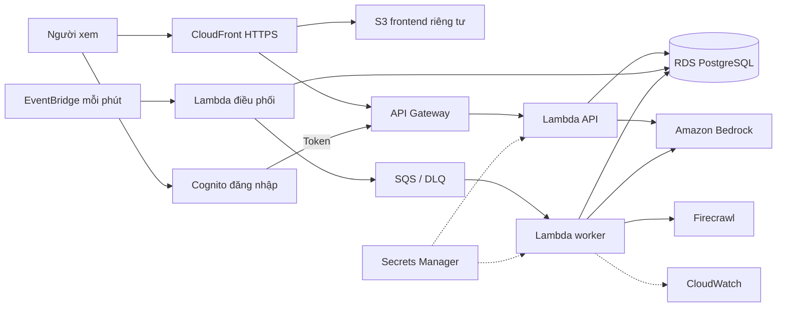

# Giai đoạn 8 — Triển khai AWS và nghiệm thu

**27/11/2026 — Dữ liệu giả đổi sang KFCC:** gói `demo-minute-20261127/backend-kfcc.zip` (backend 138/138 trên PostgreSQL sạch) đã cập nhật stack API (worker) và EC2 (`UPDATE_COMPLETE`, hai máy mới `Healthy`, `/api/health` 200); frontend có gợi ý KFCC đã lên hosting. Chưa chạy thử dòng dữ liệu KFCC trên AWS. Hướng dẫn: [thao_tac_tung_buoc.md](../../demo/thao_tac_tung_buoc.md).

**27/11/2026 — Đã triển khai email theo nhãn hàng lên AWS:** kiểm thử trước khi triển khai: backend 138/138 đạt trên PostgreSQL 18 riêng (migration đến `0021`, `alembic check` sạch, không bỏ qua), frontend build đạt, 18 kiểm thử đạt (1 bỏ qua). Gói `demo-minute-20261127/backend-email.zip`; stack API cập nhật template mới với `AlertSenderEmail` (địa chỉ của nhóm trưởng, đã xác minh SES; không ghi vào tài liệu), migration Lambda trả `ok`; stack EC2 thay lần lượt hai máy, cả hai `Healthy`, `/api/health` 200, `/api/brands/{id}/alert-recipients` trả 401 khi thiếu token (route mới đã chạy). Frontend có mục **Email nhận cảnh báo** đã tải lên hosting, invalidation xong. SES còn sandbox: chỉ gửi tới địa chỉ đã xác minh, tối đa 200 thư/ngày; một email thử gửi trực tiếp qua SES đã được nhận. Chưa kiểm chứng trọn luồng worker → SES khi cảnh báo xảy ra; cần diễn tập: nhập địa chỉ đã xác minh trong tab Cảnh báo, chạy `demo_control.py start` và chờ email.

**Cập nhật 27/11/2026 (trước triển khai):** Mã email demo chuyển sang SES và cấu hình người nhận theo nhãn hàng; chưa triển khai lên AWS. Cần xác minh sender SES, kiểm tra sandbox, cấu hình `AlertSenderEmail` và `AppBaseUrl`, migration `0021`, cập nhật API/worker/frontend và thử nhận thật; kiểm tra chi phí trong ngân sách.

**Link web demo cố định:** https://d1ymt5wg42h5sa.cloudfront.net (stack `brand-tracking-demo-frontend-20261122`, bucket `brand-tracking-demo-frontend-202611-frontendbucket-zlbh2jwx90d9`, distribution `E16UVUGRUO3EVT`). Link không đổi khi đóng tab, tắt máy, tải bản web mới, cập nhật stack hay tắt rồi bật CloudFront; trong lúc CloudFront tắt thì không truy cập được. Link chỉ đổi khi xóa stack hoặc distribution rồi tạo lại; khi đó phải sửa callback/logout Cognito, `AppBaseUrl` cho email, `CorsOrigins` và build lại frontend. Không xóa stack hosting khi dọn tài nguyên; S3 + CloudFront rẻ, phí chính nằm ở EC2/ALB/RDS.

**27/11 — Giao diện mới trên hosting:** đã tải lên giao diện chia tab, trang chào mới (thương hiệu minh họa KFCC, logo mới) và bật managed login v2 có branding cho pool `brand-demo-minute-auth-20261127` (template [cognito-demo.yaml](../../infrastructure/cognito-demo.yaml), script [apply_branding.py](../../infrastructure/cognito-branding/apply_branding.py)). Chrome mở được trang chào, trang đăng nhập và trang đăng ký, `/api/health` trả 200. Chưa gửi form đăng ký thật và chưa chạy lại `aws-demo-minute.cjs` trên bản mới.

**27/11 — Đã dựng và diễn tập demo theo phút trên AWS:**
- **Stack đang chạy và tính phí:**
  - `brand-demo-minute-data-20261127`: RDS và NAT;
  - `brand-demo-minute-auth-20261127`;
  - `brand-demo-minute-api-20261127`: worker, lịch đã tắt;
  - `brand-demo-minute-ec2-20261127`: 2 EC2 và ALB;
  - hosting `brand-tracking-demo-frontend-20261122` đã bật CloudFront và thêm `/api/*`.
- Artifact nằm trong prefix `demo-minute-20261127/` của bucket artifact cũ. Danh sách version `index.html` trước khi ghi đè được lưu trong scratchpad của phiên.
- Kết quả diễn tập chi tiết từng ghi trong `docs/development-process/demo_update_plan.md`, đã xóa ngày 27/11 khi chuyển tài liệu demo sang [thư mục demo](../../demo/architecture.md); xem lại qua lịch sử git.
- Stack review cũ `brand-demo-review-data-20261127` vẫn `DELETE_FAILED`, chỉ còn VPC/subnet/SG (không tính phí). Lệnh xóa lại bị chính sách tự động chặn; cần người dùng xóa.

**27/11 — Template demo mới** (đều qua cfn-lint):
- [aws-demo-ec2-api.yaml](../../infrastructure/aws-demo-ec2-api.yaml): API chạy trên EC2 trong Auto Scaling Group 1–3 máy sau ALB; ALB chỉ nhận yêu cầu có header bí mật từ CloudFront.
- CloudFront chuyển `/api/*` đến ALB và dùng CloudFront Function cho đường dẫn SPA.
- `aws-dev-api.yaml` thêm SNS email cảnh báo và tham số `ApiGatewayEnabled`.
- `aws-demo-data.yaml` thêm subnet công khai thứ hai.

Các template này đã được dùng để dựng môi trường như ghi ở mục ngay phía trên. Chi phí ước tính khoảng 2 USD/ngày cho EC2, ALB và IPv4, chưa gồm RDS/NAT. Thứ tự dựng và giới hạn xem [hạ tầng](../../infrastructure/README.md#demo-theo-phút-dữ-liệu-giả-cảnh-báo-và-email-2711-chưa-thử-trên-aws). Lệnh vận hành khi quay xem [thư mục demo](../../demo/architecture.md).

**27/11 — Chuyển hướng demo:** Trong lượt review, stack API/data/auth đã tạo, migration thành công, Chrome qua CloudFront đăng ký tài khoản giả và tạo nhãn hàng. Người dùng đổi hướng sang demo theo phút trước khi kết quả cảnh báo/AI được kiểm thử; lịch và mapping đã tắt, SQS báo trống, CloudFront đã `Deployed` và tắt sau phục hồi nội dung index. Đã yêu cầu xóa ba stack review và artifact, auth `DELETE_COMPLETE`, API/data đang xóa; cần kiểm tra hoàn tất và dọn log. Chưa kiểm thử bản mã mới 1–3 phút trên AWS.

**27/11/2026 — Chuẩn bị duyệt demo:** Sau khi đăng nhập lại SSO, đã xác nhận ba stack cuối trước đó `DELETE_COMPLETE`; stack data còn `DELETE_FAILED` do phụ thuộc mạng đã được yêu cầu xóa lại và xác nhận `DELETE_COMPLETE`. Hai log group còn tồn tại trong danh sách lượt cuối đã xóa; tiền tố artifact thử không còn object hoặc multipart. CloudFront `Deployed`, tắt; hai RDS cũ vẫn dừng, hai Elastic IP cũ chưa gắn, không có NAT đang hoạt động. Cost Explorer tháng 11 ước tính gần 0 USD, có độ trễ. Frontend build đạt, 18 kiểm thử đạt và một tích hợp bỏ qua; backend `unittest` 122 kiểm thử, 71 bỏ qua do thiếu môi trường. Đã yêu cầu tạo stack data và auth riêng `brand-demo-review-*-20261127`, đang tạo và chưa kiểm thử; RDS/NAT data có phí. Phải hoàn tất hoặc dọn và xác nhận các stack này, không coi demo sẵn sàng.

Data và auth review đã `CREATE_COMPLETE`; API `brand-demo-review-api-20261127` đang tạo, dùng artifact `demo-review-20261127/backend.zip` trong bucket artifact cũ. Lịch tắt, giới hạn Bedrock ba lượt/ngày/database; chưa migration hoặc kiểm thử. Cần theo dõi API, dọn artifact và cả ba stack sau lượt duyệt, trừ khi tiếp tục sử dụng theo kế hoạch có kiểm soát chi phí.

Đã tải bản frontend review lên hosting cũ và yêu cầu bật CloudFront; metadata version gốc và version mới ở `%TEMP%/brand-demo-review-backup-20261127.json`, invalidation `I9F5VG1QYNHCWHKVGXPF0CNXDQ`. Cần xác nhận, phục hồi đúng version và tắt CloudFront khi kết thúc; migration đang chạy, chưa có kết quả.

**26/11/2026 — Đang kiểm thử demo AWS:** Đã yêu cầu tạo stack tạm `brand-demo-check-data-20261126` từ template dữ liệu thử, có RDS/NAT tính phí và không backup; chỉ dùng dữ liệu giả. Cần theo dõi tạo stack, kiểm thử rồi dọn đúng stack/API/artifact và xác nhận trạng thái cuối. Hai RDS cũ đã kiểm kê đang `stopped`; không thay đổi chúng. Cost Explorer tháng 11 gần 0 USD, có độ trễ và không phải hóa đơn cuối.

Stack data đã `CREATE_COMPLETE`. Upload artifact lớn thất bại do kết nối S3; đã đưa gói mã nhỏ lên tiền tố thử và tạo stack tạm `brand-demo-check-builder-20261126` để ghép mã với artifact phụ thuộc cũ trên AWS. Cần kiểm thử artifact ghép, dọn builder và object/multipart thử; chưa có kết quả AWS đầu cuối.

Builder đã ghép artifact 17.956.327 byte thành công; đã yêu cầu tạo `brand-demo-check-api-20261126` dùng database thử, worker/SQS và demo bật cấu hình nhưng lịch/mapping tắt. Chưa chạy migration hay xác nhận API; cần theo dõi stack, thử và dọn tất cả tài nguyên thử.

API thử đã `CREATE_COMPLETE`, migration trả `ok`; Chrome qua Cognito tạo thương hiệu thử thành công. Đã yêu cầu cập nhật stack bật lịch, SQS, tối đa hai đợt và một phiên demo có hạn; bật phân tích Nova Lite với tối đa ba lượt dự phòng/ngày. Chưa xác nhận cập nhật hoàn tất hoặc có kết quả xử lý/AI. Tài khoản Cognito thử đang được harness giữ, sẽ xóa khi kiểm thử kết thúc; cần dọn stack và tài nguyên thử.

Cập nhật bật lịch đã hoàn tất; CloudWatch ghi hai phiên giả `4eea4720-8842-4971-acd9-0f013abb7c72` và `6f1e22ea-8298-4560-ba7b-8de7438b9d1c` được xếp và worker xử lý `success`. Lambda lịch sử trả 10→15; giao diện qua Cognito/API đánh giá được cảnh báo. Yêu cầu Bedrock qua API trả `failed`, chưa rõ nguyên nhân; harness thất bại và đã yêu cầu xóa tài khoản thử. Đã yêu cầu tắt lịch/mapping, cần xác nhận. Chưa hoàn thành kiểm thử AI hoặc dọn stack.

Lịch tắt được xác nhận qua cập nhật stack. Lượt thử thứ hai với tài khoản/thương hiệu khác và dữ liệu giả: Chrome/Cognito/API đánh giá cảnh báo 10→15 và Bedrock trả phân tích `success` có nhận định/dẫn chứng; harness báo đạt và xóa tài khoản thử. Trước lượt này đã bổ sung log loại lỗi không ghi nội dung/secret và cập nhật trực tiếp mã API của stack tạm; nguyên nhân lượt AI thất bại trước đó vẫn chưa xác định. Hai lượt có dữ liệu khác nhau, không đủ kết luận ổn định hay chất lượng. Stack thử và artifact còn cần dọn.

Đã thử lệnh `demo_control.py start` với cùng phiên và nhãn hàng thử: chuẩn bị lịch sử không nhân đôi và bật lịch thành công; đang theo dõi các đợt và cần thử lệnh stop. Đã validate template Cognito demo mới và yêu cầu tạo stack `brand-demo-check-auth-20261126` để kiểm thử tự đăng ký email giả. Tài nguyên thử còn tồn tại và cần dọn, kể cả pool/user demo và log Lambda của stack auth.

**Kết quả câu chuyện AWS:** Chrome dùng frontend cục bộ → Cognito demo riêng (email giả, tự xác nhận) → API Gateway/Lambda → RDS; tài khoản mới tạo nhãn hàng, `demo_control.py start` nạp lịch sử và bật lịch, EventBridge/SQS/worker xử lý hai phiên giả `94c5e442-c350-46ec-8d37-86c01b14a10b` và `791ba0da-b69c-411f-9073-bf91372d39b6` thành công. Trên cùng tài khoản, giao diện đánh giá cảnh báo 10→15 và Bedrock trả phân tích thành công; [kịch bản](../../frontend/tests/aws-demo-signup.cjs) báo đạt. Lịch sử cảnh báo dùng nhãn dựng sẵn; frontend chưa qua CloudFront trong lượt này. Một lượt AI khác đã lỗi như nêu trên. Lệnh start/stop đã thử; đang dọn stack API/data/auth/builder, tài khoản giả, log và artifact thử, cần xác nhận hoàn tất.

**Đang thử CloudFront:** Đã ghi phiên bản index gốc vào `%TEMP%/brand-demo-frontend-backup-20261126.json`; đã yêu cầu bật distribution của stack frontend cũ và cập nhật CORS/API, callback/logout của Cognito demo để thử hosting. Chưa tải build hoặc có kết quả. Cần phục hồi index gốc theo version, invalidation và tắt distribution sau thử; không xóa version cũ hay dữ liệu không thuộc lượt thử.

Đã tải hai object mới thuộc lượt thử (index và asset JS mới; asset đã tồn tại giữ nguyên) và yêu cầu invalidation `IDZ3XBB03Q1GLUO2PTJXEKTM4M`; version object thử được ghi trong tệp backup. Cần chờ distribution/stack cập nhật và invalidation, rồi thử trình duyệt. Sau thử cần phục hồi index gốc, xóa đúng version thử và tắt distribution, xác nhận hoàn tất.

Chrome qua CloudFront HTTPS và Cognito demo riêng đã tự đăng ký email giả, đăng nhập và tạo nhãn hàng trên API/RDS thử thành công. Distribution lúc kiểm tra vẫn `InProgress`; đang thử tiếp bộ sinh/cảnh báo qua hosting. Hạn mức ba lượt Bedrock/ngày của database thử đã dùng, nên lượt hosting không gọi thêm; không sửa bảng để vượt hạn mức. AI đã thử riêng ở lượt frontend cục bộ như trên.

Distribution đã `Deployed`, `Enabled=true`; trên một tài khoản mới khác, Chrome qua CloudFront/Cognito/API đã đăng ký giả lập, tạo nhãn hàng, thấy mã vận hành, dùng `demo_control.py start`, thấy bài giả và đánh giá cảnh báo 10→15. CloudWatch ghi hai phiên `54ed2ec2-cc98-4acc-bdad-d97bfb65c399` và `36ecd72d-fe01-40cc-b59f-550edbbaf1b4` thành công. Lượt này không gọi AI; phân tích Bedrock thành công ở lượt frontend cục bộ, và đã có một lượt AI lỗi. Cần dừng lịch, phục hồi frontend và dọn tài nguyên thử.

Đã xóa đúng hai version index/JS thuộc lượt thử và xác nhận index gốc trở lại theo version lưu trước; đã yêu cầu invalidation `I26PX794N8D69VVLA15FT0PYCB` và tắt distribution. Cần xác nhận cả hai hoàn tất. Đã yêu cầu tắt lịch demo bằng công cụ; theo dõi stack và dọn tài nguyên thử còn lại.

Lệnh stop hoàn tất, SQS báo không có thông điệp hiển thị hoặc đang xử lý. Đã yêu cầu xóa stack API, auth và builder thử; danh sách log group Lambda thử lưu ở `%TEMP%/brand-demo-check-loggroups-20261126.json` để dọn đúng phạm vi sau khi xóa. Cần đợi API xóa, sau đó xóa stack data; kiểm tra Cognito pool, NAT/RDS, log, object/multipart thử và trạng thái CloudFront. Đã dừng frontend cục bộ.

Đã yêu cầu xóa stack data thử khi API còn đang xóa để sớm giải phóng RDS/NAT; nếu subnet còn ENI Lambda có thể cần xóa lại sau khi API hoàn tất. Đã xóa object artifact thử và hủy multipart còn lại dưới tiền tố thử, cần kiểm tra lại. Invalidation phục hồi hoàn tất; CloudFront đã nhận `Enabled=false` nhưng còn `InProgress`.

CloudFront đã `Deployed`, `Enabled=false`; invalidation phục hồi hoàn tất. Stack auth và builder thử `DELETE_COMPLETE`, log group Lambda của hai stack đã xóa. API và data thử vẫn `DELETE_IN_PROGRESS`; tại lần kiểm tra không còn RDS có tiền tố thử. Cần tiếp tục theo dõi API/data, NAT, log API và object/multipart; xóa lại data nếu bị phụ thuộc ENI.

API lượt trước đã `DELETE_COMPLETE`, log API/migration/fixture của lượt trước đã dọn. Data lượt trước `DELETE_FAILED` do hai subnet còn phụ thuộc; sau khi API xóa, kiểm tra hai subnet không còn network interface và đã yêu cầu xóa lại. Cần xác nhận stack data hoàn tất.

AWS đã xác nhận data lượt trước xóa lại `DELETE_COMPLETE`; bốn stack `brand-demo-check-*` đều đã xóa. Lượt `brand-demo-final-*` vẫn đang chạy để ghi bản dự phòng và cần dọn riêng.

**Đang chuẩn bị diễn tập cuối:** Sau khi thay đổi diễn biến các đợt giả và kiểm thử cục bộ, đã yêu cầu tạo các stack tạm `brand-demo-final-data-20261126`, `brand-demo-final-auth-20261126` và `brand-demo-final-builder-20261126` để thử cùng một lượt CloudFront + AI trên database mới có hạn mức riêng. Data dùng template thử không backup, chỉ chứa dữ liệu giả; RDS/NAT tính phí. Đã tải gói mã nhỏ lên tiền tố artifact thử. Cần theo dõi cả stack cũ đang xóa lẫn lượt mới, dựng API/hosting, kiểm chứng và dọn/khôi phục toàn bộ sau thử; chưa có kết quả lượt cuối.

Data, auth và builder cuối đã tạo; builder ghép artifact mã mới, đã yêu cầu tạo `brand-demo-final-api-20261126` với Bedrock giới hạn ba lượt/ngày và lịch tắt. Cần chạy migration và xác nhận API trước khi thử, sau đó dọn stack này cùng ba stack trên.

Đã lưu version index gốc cho lượt cuối tại `%TEMP%/brand-demo-final-frontend-backup-20261126.json` và yêu cầu bật lại CloudFront. Chưa tải build cuối; cần phục hồi đúng version, xóa version thử, invalidation và tắt lại sau diễn tập.

Đã tải build cuối (hai object mới, version ghi trong metadata) và yêu cầu invalidation `I993CCZXCGHIS27GDI3SVZITPO`. Chưa có kết quả diễn tập cuối; cần phục hồi và tắt sau thử.

API cuối đã `CREATE_COMPLETE`, migration trả `ok`, CloudFront `Deployed`/bật. Chrome qua hosting và Cognito demo đã tự đăng ký/tạo thương hiệu mới; đang chạy `demo_control.py start` với hai đợt và chờ kết quả cảnh báo/AI. Chưa kết luận lượt cuối; sau thử cần dừng và dọn.

Hai phiên cuối `16880e07-dfa2-47eb-b571-5de7ad5735b1` và `0c64ebb9-f749-4d75-8972-1330d9d08a76` được worker AWS báo thành công, nhưng kiểm thử trình duyệt dừng ở kiểm tra số đợt hiển thị trước bước cảnh báo/AI. Chưa chứng minh giao diện đủ hai đợt; đã điều chỉnh kiểm thử để đợi phản hồi tải lại và đang chạy lại. Đã yêu cầu tắt lịch trước lượt mới.

Lượt chạy lại qua CloudFront đã xác nhận hai đợt `f1fd952e-7051-4369-b3d4-9bb0b17edef4` và `9fc1a487-1a13-4511-b6c7-057be2d1729a`, nội dung chuyển từ nhiều lời khen sang nhiều phàn nàn, cùng cảnh báo 10→15. Hai yêu cầu AI trả `provider_error`; log cho biết lỗi `ValueError` khi xử lý kết quả, chưa đủ chi tiết để kết luận nguyên nhân. Đang bổ sung log phân loại bước lỗi không ghi dữ liệu nguồn và kiểm tra tiếp; không đánh dấu demo AI sẵn sàng.

**Lượt hoàn chỉnh CloudFront:** Sau khi bổ sung log chẩn đoán an toàn, một tài khoản demo mới đã tự đăng ký, tạo nhãn hàng, xem đủ hai đợt có tỷ lệ nội dung tích cực 4/6 rồi 2/6, đánh giá cảnh báo 10→15 và nhận phân tích Bedrock có dẫn chứng qua CloudFront/Cognito/API AWS; [kịch bản](../../frontend/tests/aws-demo-signup.cjs) báo `DEMO_COMPLETE_FLOW_OK`. CloudWatch ghi hai phiên `855be8df-b142-41cf-8241-2079320ba654` và `849087a1-4819-414b-8cbb-aa0dd6a328e8` thành công. Lịch sử cảnh báo và nhãn cảm xúc là giả/gán sẵn, không chứng minh chất lượng mô hình. Hai lượt AI trước vẫn thất bại, chưa có log đủ xác định nguyên nhân; cần diễn tập và có kết quả/video dự phòng. Tài nguyên lượt cuối còn hoạt động và cần dọn.

Đã ghi [video dự phòng luồng chính](evidence/demo-core-20261126.mp4) từ CloudFront với dữ liệu giả, cắt thời gian chờ và gắn nhãn trong video; không có AI/console. Đã chụp [ảnh kết quả AI đã lưu](evidence/demo-ai-20261126.png) từ lượt thành công; ảnh cần đi kèm nhãn dữ liệu giả vì giao diện trong ảnh không tự gắn nhãn này. Cả hai đã xem kiểm tra; không thay cho diễn tập trực tiếp.

**Dọn lượt cuối đang thực hiện:** Đã dừng lịch/mapping, SQS báo không có thông điệp đang chờ hoặc xử lý. Đã phục hồi index gốc đúng version, xóa hai version frontend thuộc lượt cuối, yêu cầu invalidation `I8X0CUQON9KVUE1B4WKHPFS1QV` và tắt CloudFront; cần xác nhận. Đã yêu cầu xóa bốn stack `brand-demo-final-*` và xóa object artifact thử; log group Lambda của lượt cuối được lưu danh sách trong `%TEMP%/brand-demo-final-loggroups-20261126.json` để dọn sau khi stack xóa. Data thử có thể phải xóa lại sau khi Lambda giải phóng ENI. Cần kiểm kê RDS, NAT, IP, Cognito, log, S3/multipart và chi phí sau khi xóa.

**26/11/2026 — Định hướng demo:** Người dùng ưu tiên trình diễn kiến trúc và luồng sử dụng có dữ liệu giả sinh liên tục, kèm quan sát AWS. [Thư mục demo](../../demo/architecture.md) là kịch bản và hướng dẫn chuẩn bị chính; mục kịch bản bên dưới giữ lại làm tham khảo và bằng chứng lịch sử. Chưa triển khai hoặc diễn tập luồng sinh liên tục trên AWS; bước tiếp theo là xây dựng và kiểm chứng theo kế hoạch, trong giới hạn chi phí và quyền sử dụng nguồn.

**26/11/2026 — Bộ sinh demo:** Đã có mã nguồn giả, lập lịch hữu hạn và chọn provider cho Lambda/SQS, mặc định tắt. PostgreSQL riêng và SQS giả đã thử; template `aws-dev-api.yaml` qua AWS `validate-template`. Chưa triển khai luồng này lên AWS hoặc thử trình duyệt. Chi tiết và việc tiếp theo tại [thư mục demo](../../demo/architecture.md).

**26/11/2026 — Cảnh báo demo:** Đã thêm Lambda fixture có điều kiện tạo lịch sử 10→15 với nhãn dựng sẵn. Kiểm thử PostgreSQL chứng minh đánh giá và chống lặp; template AWS validate, chưa triển khai. [Thư mục demo](../../demo/architecture.md).

**26/11/2026 — Kiểm tra template:** AWS CloudFormation `validate-template` chấp nhận `aws-demo-data.yaml`, `aws-demo-frontend.yaml`, `aws-dev-api.yaml` và `cognito.yaml`; không tạo tài nguyên. Kiểm tra cú pháp này không chứng minh triển khai thành công hoặc nghiệm thu bảo mật/chi phí.

**26/11/2026 — Kiểm kê sau đăng nhập SSO:** STS thành công; tại `ap-southeast-1`, hai stack thử backup và các stack thử hosting/xóa đều `DELETE_COMPLETE`. Không thấy RDS thử backup, snapshot thủ công thử backup, backup tự động được liệt kê hoặc secret có tên chứa `backup` (kể cả secret đang chờ xóa); không khẳng định đã kiểm tra mọi tài nguyên theo mọi tên. Hai RDS `brand-tracking-item1-*` vẫn `stopped`, hai snapshot cũ `available`; AWS báo tự khởi động lại lúc khoảng **19:10–19:11 ngày 29/11/2026 giờ Việt Nam**. Hai Elastic IP thuộc hai stack data cũ chưa gắn và có thể tính phí. Không có NAT Gateway trạng thái pending/available/deleting; EventBridge rule và SQS mapping của worker cũ tắt, CloudFront tắt. Năm stack cũ/frontend/Cognito vẫn tồn tại. Cost Explorer ước tính chi phí toàn tài khoản tháng 11 gần 0 USD, có độ trễ và chưa phải hóa đơn cuối. Không thay đổi hoặc xóa tài nguyên; tiếp tục theo dõi RDS, chi phí và xác định phương án giữ dữ liệu trước khi dọn stack cũ.

**26/11/2026 — Kiểm tra tiếp:** `aws sts get-caller-identity` với profile `profile-name-logn` thất bại vì token SSO hết hạn; chưa kiểm kê được tài nguyên hoặc chi phí AWS hiện tại. Cần đăng nhập lại rồi kiểm tra các tài nguyên cũ và lượt thử backup trước khi kết luận đã dọn. Frontend build đạt, 18 kiểm thử đạt và một tích hợp bỏ qua. Backend chạy 116 kiểm thử, 67 bỏ qua do thiếu điều kiện thử; không thay thế kết quả PostgreSQL đầy đủ ngày 23/11. Đã sửa các mô tả lỗi thời về xóa nhãn hàng và kết quả AI/cảnh báo trong README. Không tạo hay xóa tài nguyên AWS trong lượt này.

**23/11/2026 — Kiểm kê sau đăng nhập lại:** CloudFormation xác nhận các stack thử `brand-signup-check-20261123`, `brand-queue-check-*`, `brand-ai-check-*` và `brand-acceptance-*` đều `DELETE_COMPLETE`; không có stack `DELETE_FAILED`. Hai RDS `brand-tracking-item1-*` vẫn `stopped`; không có NAT Gateway ở trạng thái đang tạo, hoạt động hay đang xóa. Cost Explorer tháng 11 trả chi phí toàn tài khoản ước tính gần 0 USD, có độ trễ, không phải hóa đơn cuối cùng. Không xóa stack cũ, snapshot hoặc dữ liệu. Hosting frontend và các stack cũ vẫn tồn tại.

**Kế hoạch tiếp tục theo yêu cầu:** (1) Kiểm kê cấu hình và chi phí, giữ snapshot và giới hạn AWS 30 USD; (2) kiểm thử chức năng còn thiếu với môi trường cách ly, ghi riêng dữ liệu thật và giả; (3) nối hosting, Cognito, API và kiểm thử luồng demo; (4) rà soát cảnh báo, AI, khôi phục và tiêu chí SRS; (5) viết kịch bản thuyết trình, tắt tài nguyên không cần thiết và ghi bằng chứng cùng giới hạn. Chỉ đánh dấu đạt các bước có kết quả kiểm chứng; nhóm vẫn cần xác nhận yêu cầu và nhãn dữ liệu khi tiêu chí đòi hỏi.

**23/11/2026 — Chuẩn bị thử hosting đầu cuối:** Đã yêu cầu tạo stack database/mạng tạm `brand-demo-e2e-data-20261123` từ template thử có RDS và NAT tính phí; không đưa dữ liệu thật cần lưu vào stack này vì database bị xóa khi xóa stack. Hai snapshot thủ công cũ vẫn `available`. Cần theo dõi tạo stack, thử hosting và chủ động dọn stack tạm cùng xác nhận trạng thái sau khi xóa.

Đã sao lưu `index.html` hiện tại vào tệp tạm trên máy và yêu cầu bật CloudFront stack `brand-tracking-demo-frontend-20261122`; thay đổi đang thực hiện, chưa chứng minh hosting hoạt động. Backend thử đã đóng gói và tải lên tiền tố `demo-e2e-20261123/` trong bucket artifact cũ. Watchdog PID `31204` dự kiến xóa hai stack thử sau 75 phút, PID `40180` dự kiến khôi phục index và tắt CloudFront sau khoảng 73 phút; cả hai chỉ dự phòng, phụ thuộc phiên SSO và không thay thế dọn chủ động hoặc xác nhận.

Database/mạng thử đã `CREATE_COMPLETE`; đã yêu cầu tạo `brand-demo-e2e-api-20261123` dùng database thử và CORS cho URL CloudFront, worker mặc định tắt. Cần đợi API tạo xong, chạy migration, sau đó mới kiểm thử. Không xem việc tạo stack là bằng chứng nghiệm thu.

CloudFront đã `Deployed`, bật tạm; build frontend trỏ API thử đã được tải lên bucket và yêu cầu invalidation `IAP8TP1I6NFSLPPRDDEE16HP4R`. Đây là bản thử ngắn hạn, API và RDS sẽ bị dọn sau thử; cần khôi phục index cũ, invalidation và tắt CloudFront khi kết thúc.

API thử đã `CREATE_COMPLETE`; Lambda migration trả `status: ok`. Đang chạy kiểm thử trình duyệt dùng hai tài khoản Cognito tạm tự xóa với URL CloudFront, chưa có kết luận kiểm thử.

**Kết quả hosting đầu cuối 23/11:** Chrome chạy từ URL CloudFront HTTPS qua Cognito thật và API Gateway/Lambda/RDS thử: đăng nhập, tạo nhãn hàng và lưu cấu hình, làm mới token, cách ly đọc/sửa giữa hai tài khoản và đăng xuất managed login đều đạt. Hai tài khoản thử được harness xóa; tại thời điểm đó worker và AI chưa bật. [Kịch bản kiểm thử](../../backend/tests/cognito_browser_check.py) lúc đó được điều chỉnh tạm cho đúng URL và stack thử; phiên bản hiện tại chỉ cho phép hosting với stack `brand-delete-check-api-*`, database `brand-delete-check-data-*` và URL đối chiếu output CloudFormation. [Trình duyệt](../../frontend/tests/cognito-browser.cjs).

**Đang chuẩn bị tracking qua hosting:** Firecrawl báo còn 1.348 credit trước thử. Đã yêu cầu cập nhật riêng stack API thử để bật worker và SQS; dự phòng tối đa tám credit/ngày và bốn credit/phiên trong database thử, tối đa hai lời gọi/phiên, không tự retry. Đây là dự phòng ước tính, không phải trần cứng tại Firecrawl. Chưa có kết quả tracking; cần tắt rule/mapping và xóa stack khi hoàn tất.

**Kiểm thử backend cục bộ 23/11:** PostgreSQL 18 riêng, chỉ nghe localhost, khởi tạo UTF-8; nâng migration, `alembic check` và 114 kiểm thử backend đạt, không bỏ qua. Lượt đầu cluster mặc định Windows-1252 làm 10 kiểm thử lỗi mã hóa tiếng Việt; sau khi tạo lại UTF-8 toàn bộ đạt. Cluster thử đã dừng và xóa, không dùng database đang có.

**Tracking qua hosting 23/11:** Hai phiên `Starbucks Vietnam` chạy qua CloudFront/Cognito/API Gateway, SQS và worker Firecrawl thật đều `success`; lần lượt lưu một bài/40 bình luận và một bài/48 bình luận. Hai bài khác định danh nên lượt này không chứng minh khử trùng cùng bài. Kiểm thử đăng nhập, refresh, cách ly và logout cùng lượt đạt. Đã tắt rule tạm và yêu cầu tắt mapping sau thử; cần xác nhận và dọn tài nguyên.

**Đang chuẩn bị AI qua hosting:** Đã yêu cầu bật phân tích Nova Lite với hạn mức ba lượt/ngày trong database thử; profile APAC có thể xử lý ngoài Region Singapore. Đã yêu cầu tạo Lambda fixture `brand-demo-e2e-fixture-20261123` chỉ nhận host database thử để nạp dữ liệu giả cho phân tích và cảnh báo. Watchdog PID `15172` dự phòng xóa Lambda này; cần chủ động xóa Lambda, log group và hai artifact thử, cũng như dọn hai stack. Chưa có kết quả AI hoặc cảnh báo trên hosting trong lượt này.

**AI và cảnh báo qua hosting 23/11:** Chrome từ CloudFront qua Cognito và API Gateway/Lambda gọi Bedrock Nova Lite thành công với một bài giả; kết quả có ID dẫn chứng thuộc bài được nạp và liên kết hiển thị. Trên hai cửa sổ dữ liệu giả 10→15, ngưỡng 50% tạo một cảnh báo, đánh giá lại không tạo bản sao. Tài khoản khác không đọc được kết quả phân tích. Đây là kiểm thử chức năng với nội dung và nhãn giả, không chứng minh chất lượng phân loại hay ngữ nghĩa nhận định trên dữ liệu thật.

**Dọn sau thử hosting:** Đã xóa Lambda fixture, log fixture và hai object artifact thử; đã phục hồi `index.html` gốc, yêu cầu invalidation `ID3TQGO01DB3RM5ZHIE8FZMDYR`, tắt CloudFront và xóa hai stack thử. Cần xác nhận các thao tác hoàn tất, kiểm tra RDS/NAT và xử lý nếu stack xóa thất bại. Không xóa các stack, snapshot hoặc dữ liệu cũ; bucket frontend versioning vẫn có thể giữ version và asset thử.

Firecrawl báo 1.344 credit sau lượt thử, so với 1.348 trước lượt thử; chênh lệch số dư không phải hóa đơn chi tiết. Cost Explorer tháng 11 vẫn ước tính gần 0 USD toàn tài khoản, có độ trễ và không phải chi phí cuối cùng. CloudFront đã `Deployed`, `Enabled=false`; stack frontend `UPDATE_COMPLETE`. Hai stack API/data thử vẫn `DELETE_IN_PROGRESS`, RDS thử `deleting`, không còn NAT đang hoạt động hoặc đang xóa tại lần kiểm tra.

**Cập nhật dọn:** API thử không còn được `describe-stacks` tìm thấy. Stack data từng `DELETE_FAILED` do subnet còn phụ thuộc; kiểm tra sau đó không thấy network interface trong các subnet còn lại nên đã yêu cầu xóa lại. RDS/NAT của lượt thử cũ không còn. Cần xác nhận stack data xóa xong; stack thử xóa nhãn hàng mới được tạo riêng và có RDS/NAT riêng.

AWS sau đó xác nhận cả `brand-demo-e2e-api-20261123` và `brand-demo-e2e-data-20261123` đều `DELETE_COMPLETE`; watcher PID `31204` đã dừng. Stack xóa nhãn hàng mới là môi trường khác và vẫn cần dọn.

**Đang thử template bảo vệ dữ liệu 23/11:** Đã yêu cầu tạo `brand-backup-template-check-20261123` từ `aws-demo-data.yaml`, database trống riêng, backup bảy ngày, snapshot và secret được giữ khi xóa theo template. RDS/NAT, snapshot và secret có thể tính phí; không dùng dữ liệu cần giữ. Watchdog PID `14948` dự phòng yêu cầu xóa stack sau 35 phút nhưng không xóa snapshot/secret được giữ; phải kiểm kê, dọn đúng tài nguyên thử và xác nhận. Chưa có kết quả triển khai hay khôi phục.

Watchdog PID `21184` thay PID `5656`, dự phòng sau khoảng 35 phút: chỉ sau khi stack thử xóa hoàn toàn, xóa snapshot thủ công, backup tự động được giữ thuộc đúng RDS trống của stack và secret được giữ của chính stack này. Nó không thay thế kiểm tra chủ động và phụ thuộc SSO; các snapshot cũ không thuộc phạm vi. Cần kiểm tra trạng thái và dừng watchdog khi dọn xong để tránh thao tác muộn.

Dự kiến nạp duy nhất một dấu kiểm giả vào database thử qua Lambda riêng, tạo snapshot riêng, khôi phục sang RDS thử thứ hai và so sánh dấu kiểm; không đọc dữ liệu cũ. Hai database, snapshot và Lambda thử cần được dọn sau kiểm thử. Chưa có kết quả khôi phục từ template demo.

AWS đã trả cấu hình RDS thử: backup retention 7 ngày, mã hóa bật, không public; tại lần đọc instance còn `configuring-enhanced-monitoring`, stack chưa hoàn tất. Đây là xác nhận cấu hình, chưa phải kiểm chứng sao lưu hoặc khôi phục.

AWS đã liệt kê một backup tự động `available` cho RDS thử lúc 06:38 UTC ngày 23/11; đây là backup của database trước khi nạp dấu kiểm, chưa chứng minh dữ liệu ghi sau đó được khôi phục. Cần kiểm tra snapshot riêng sau khi ghi và giữ giới hạn về dữ liệu thử.

Stack `brand-backup-template-check-20261123` đã `CREATE_COMPLETE`; RDS `available`, backup retention 7 ngày, mã hóa bật và không public. Lambda fixture đang tạo. Chưa kiểm chứng khôi phục.

Lambda fixture đã ghi và đọc một dấu kiểm giả trong database thử; đã yêu cầu tạo snapshot thủ công `brand-backup-manual-check-20261123`, đang `creating`. Chưa khôi phục, chưa chứng minh backup tự động sau khi ghi hay dữ liệu thực tế.

Snapshot thủ công đã `available`, 100%; đã yêu cầu khôi phục sang `brand-backup-restore-check-20261123` riêng, private, không bật backup tự động cho bản thử. Instance đang `creating`, chưa kiểm chứng dữ liệu khôi phục. Snapshot này là thủ công; không suy ra backup tự động sau khi ghi có cùng nội dung.

Instance khôi phục đã có endpoint riêng và đang `configuring-enhanced-monitoring`; Lambda fixture được chuyển sang host này để chuẩn bị đọc. Chưa có kết quả đối chiếu dấu kiểm.

**Kết quả khôi phục template demo 23/11:** RDS khôi phục private/mã hóa đã `available`; Lambda đọc được đúng hàng dấu kiểm giả đã ghi ở nguồn trước snapshot thủ công. Phép thử xác nhận một vòng ghi → snapshot thủ công → restore → đọc một hàng; không chứng minh backup tự động sau khi ghi, toàn bộ schema/dữ liệu thật hay cách ly tài khoản trong bản khôi phục. Đã yêu cầu xóa RDS khôi phục, stack fixture và stack data, xóa artifact/log fixture; cần theo dõi snapshot cuối do `DeletionPolicy: Snapshot`, backup tự động và secret được giữ rồi dọn đúng tài nguyên thử. Hai snapshot cũ không thuộc phép thử.

Khi xóa stack, AWS đã tạo snapshot cuối của RDS thử ở trạng thái `creating` và backup tự động thử có trạng thái `retained`; snapshot thủ công dùng cho phép khôi phục đã xóa. Hai RDS thử đang `deleting`; vẫn cần chờ snapshot cuối, stack và dọn bản giữ lại.

Watchdog PID `36800` dự phòng xóa RDS khôi phục riêng `brand-backup-restore-check-20261123`, stack Lambda thử `brand-backup-fixture-check-20261123` và artifact của lượt thử sau 28 phút; RDS khôi phục chưa tồn tại tại lúc thiết lập. Các watcher chỉ dự phòng, cần dọn và xác nhận thủ công.

RDS nguồn thử đã có endpoint và đang `backing-up`; đã yêu cầu tạo stack Lambda fixture với quyền chỉ đọc secret của database thử và chỉ cho phép host thử. Artifact fixture chỉ chứa mã và dấu kiểm giả được truyền lúc chạy, không chứa khóa. Cần đợi sẵn sàng trước khi ghi hoặc tạo snapshot.

**23/11/2026 — Kết quả SQS/lịch:** Stack thử chạy migration thành công; EventBridge tạo phiên đến hạn, outbox → SQS → Lambda/Firecrawl thành công. Thông điệp SQS lặp được consumer nhận, không thay đổi kết quả phiên hoặc credit dự phòng. Lease hết hạn giả lập được đánh dấu `worker_timeout`; phiên phục hồi được xếp và xử lý thành công qua SQS. Tạm dừng nhãn hàng ngăn phiên mới ở lần quét tiếp theo. Hai lần đầu kịch bản bỏ sót log do phân trang và đồng hồ máy nhanh hơn AWS; đã sửa phép chờ và chạy lại trên cùng nhãn hàng. Chưa mô phỏng giết Lambda đang xử lý hoặc bảo đảm exactly-once. Rule đã tắt, mapping yêu cầu tắt; Lambda fixture, object S3 và log thử đã xóa. Hai stack đang `DELETE_IN_PROGRESS`, RDS/NAT thử đang xóa; watcher PID `10556` thử dọn lại nếu lỗi, không thay thế xác nhận. [S5](s5_tracking.md).

**23/11/2026 — Stack SQS đang khởi tạo:** Đã yêu cầu tạo `brand-queue-check-api-20261123` và Lambda `brand-queue-check-fixture-20261123` trên database thử; rule/mapping ban đầu tắt, worker giới hạn hai lời gọi mỗi phiên và dự phòng 12 credit/ngày. Chưa chạy migration hay kiểm thử. Cần xóa hai stack, Lambda, log group và object `queue-check/` tạo riêng sau thử; watchdog PID `30384` chỉ dự phòng.

**23/11/2026 — Dọn stack AI:** AWS xác nhận `brand-ai-check-api-20261123` và `brand-ai-check-data-20261123` đều `DELETE_COMPLETE`; RDS/NAT thử đã xóa.

**23/11/2026 — Đang chuẩn bị kiểm thử SQS/lịch:** Đã yêu cầu tạo stack dữ liệu riêng `brand-queue-check-data-20261123` từ template tạm, RDS/NAT tính phí. Dự kiến tạo `brand-queue-check-api-20261123` và Lambda fixture chỉ dành cho database này; thử lịch tạo phiên, phát lại thông điệp, lease hết hạn và phục hồi. Firecrawl còn 1.352 credit trước lượt thử. Watchdog PID `30384` chỉ dự phòng sau 90 phút; phải theo dõi và chủ động dọn/xác nhận.

**23/11/2026 — AI và cảnh báo đầu cuối:** Trên stack API/RDS thử, Chrome qua Cognito gửi một bài giả đến phân tích Bedrock thật; kết quả thành công có ID dẫn chứng hợp lệ và liên kết hiển thị. Tài khoản thứ hai nhận 404 khi đọc phân tích. Với hai cửa sổ giả 10→15, quy tắc 50% tạo cảnh báo qua giao diện/API Gateway, đánh giá lại trả cùng ID và lịch sử chỉ có một mục. Lượt chạy đầu thành công; lượt sau lộ lỗi chờ danh sách trong kịch bản kiểm thử, đã sửa và chạy lại thành công. Ba lượt AI dùng hạn mức dự phòng ba lời gọi trong database thử. Tài khoản thử và object S3/log/Lambda fixture thử đã xóa; stack API và data đang `DELETE_IN_PROGRESS`, NAT đã `deleted`, RDS thử không còn trong danh sách; stack còn chờ tài nguyên mạng Lambda. Watchdog dọn PID `38736` kiểm tra và thử lại khi stack `DELETE_FAILED`; PID `18176` là dự phòng, phải xác nhận trạng thái AWS. Chưa thử với dữ liệu thật đại diện hoặc chứng minh nội dung nhận định đúng ngữ nghĩa. [S6](s6_sentiment_alerts.md), [S7](s7_ai_analysis.md).

**23/11/2026 — Hoàn tất dọn lượt trước:** Stack API thử cũ đã biến mất; stack data ban đầu `DELETE_FAILED` vì hai subnet còn ENI Lambda. Sau khi ENI biến mất, yêu cầu xóa lại và AWS không còn tìm thấy stack data. RDS và NAT thử đã xóa; hai RDS cũ vẫn dừng.

**23/11/2026 — Đang chuẩn bị thử AI đầu cuối:** Đã yêu cầu tạo stack `brand-ai-check-data-20261123` từ template database thử không lưu dữ liệu lâu dài; RDS/NAT có thể tính phí. Dự kiến tạo stack API `brand-ai-check-api-20261123` và Lambda nạp đúng một bài giả, dùng Cognito thật, trình duyệt và Bedrock; không gửi dữ liệu cá nhân. Watchdog PID `18176` dự kiến dọn các tài nguyên thử sau 90 phút; phải kiểm tra thực tế và chủ động dọn, không coi watchdog là bằng chứng đã dọn. Hai stack thử trước vẫn chờ xóa ENI.

**23/11/2026 — Kết quả AWS thử:** Migration Lambda trả `ok`. Hai tài khoản Cognito thử xác nhận đăng nhập, refresh, logout và cách ly đọc/sửa. Hai phiên Firecrawl thật cùng bài, mỗi phiên trả một bài và 43 bình luận; worker phân loại ba nội dung, còn 41 mục chờ trong lô đầu. Firecrawl báo 1.356 credit trước thử; hạn mức database thử dự phòng 10 credit và 10 lượt Bedrock mỗi ngày, không giới hạn toàn tài khoản. Probe Lambda dùng vai trò API/worker gọi Nova Lite với dữ liệu giả thành công; 11 kiểm thử cảnh báo và phân tích với TestClient/model giả trên RDS thử đều đạt. Ở lượt đó chưa thử AI thật qua API Gateway; đã thử sau đó với dữ liệu giả như ghi phía trên. Chưa thử cảnh báo với dữ liệu thật đủ hai cửa sổ hoặc SQS phiên bản mới. Rule đã tắt, tài khoản thử và artifact S3 thử đã xóa.

**Dọn sau thử:** API và data thử đang `DELETE_IN_PROGRESS`; RDS thử không còn trong danh sách, NAT thử đã `deleted`, còn chờ tài nguyên mạng Lambda. Probe Lambda, các object S3 và log group thử đã xóa. Cần xác nhận xóa xong và xử lý `DELETE_FAILED`; hai RDS cũ không thuộc các stack này. Watchdog PID `17828` và `47648` là dự phòng, không thay thế xác nhận.

**Quyền Bedrock:** Template API bổ sung quyền model nền tùy chọn, ràng buộc theo inference profile; AWS validate và cfn-lint đạt, probe Lambda đã gọi thành công với từng vai trò. Profile Nova Lite APAC có thể định tuyến dữ liệu qua Region khác. [Hướng dẫn](../../infrastructure/README.md).

**22/11/2026 — Kiểm thử cục bộ:** PostgreSQL riêng chạy đủ migration, alembic check và 112 kiểm thử backend đạt; kiểm thử client tích hợp và Chrome smoke giả cũng đạt. [S1](s1_frontend.md).

**22/11/2026 — Thử frontend hosting:** Stack `brand-tracking-demo-frontend-20261122` đã `CREATE_COMPLETE`; build dùng API/Cognito cũ được đưa lên bucket. HTTPS CloudFront trả 200 cho `/`, JavaScript trả 200 với `application/javascript`, `/auth/callback` trả trang SPA; truy cập trực tiếp S3 ẩn danh trả 403. Chrome headless mở trang không có `pageerror`, nút đăng nhập chuyển tới Cognito với PKCE S256 và callback HTTPS đúng; chưa đăng nhập bằng tài khoản hoặc gọi API. Cognito stack `UPDATE_COMPLETE`, xác nhận giữ hai URL localhost và thêm URL demo. Đã cập nhật `DistributionEnabled=false`, stack `UPDATE_COMPLETE` và CloudFront `Deployed`, `Enabled=false`; trang không phục vụ khi tắt. Bucket, các phiên bản object và các tài nguyên giữ lại có thể tính phí. Khi thử tiếp cần bật distribution, khôi phục NAT/RDS hoặc triển khai backend demo, cấu hình CORS và kiểm thử đầy đủ.

**22/11/2026 — Đang thử frontend hosting:** Đã yêu cầu tạo stack `brand-tracking-demo-frontend-20261122` từ template `aws-demo-frontend.yaml` có tham số tắt phân phối; AWS trả `CREATE_IN_PROGRESS`. Build frontend cấu hình URL API/Cognito hiện có thành công, nhưng database và NAT của API cũ đang dừng nên build này chưa chứng minh API hoạt động. Template Cognito thêm URL callback/logout demo tùy chọn và qua validate/lint, chưa cập nhật stack. Cần theo dõi stack, xuất bản build, kiểm tra HTTPS/OAC/callback và cấu hình Cognito/CORS trước khi kết luận; tắt phân phối khi không làm việc. Bucket versioning được giữ khi xóa stack và vẫn có thể tính phí.

**Cập nhật hosting:** Build đã tải lên bucket `brand-tracking-demo-frontend-202611-frontendbucket-zlbh2jwx90d9`; distribution `E16UVUGRUO3EVT` có domain `d1ymt5wg42h5sa.cloudfront.net`, lần đọc trả `InProgress`. Change set Cognito `add-demo-urls-20261122` chỉ sửa `WebClient`, không thay thế; đã yêu cầu thực thi để thêm callback/logout HTTPS và giữ URL localhost. Cần kiểm tra hai stack, quyền truy cập bucket, HTTPS và callback. Chưa kiểm chứng đăng nhập hoặc API thật trên hosting này.

**22/11/2026 — Hoàn tất dọn diễn tập:** AWS waiter xác nhận `brand-restore-check-20261122` đã xóa; truy vấn instance chỉ còn hai database nguồn, đều `stopped`. Backup tự động của instance thử không còn được tìm thấy; Lambda và log group thử đã xóa. Hai snapshot nguồn vẫn `available`, mã hóa; hai NAT vẫn `deleted`. Giới hạn bằng chứng khôi phục là truy vấn schema và số lượng tổng hợp bên dưới, chưa đối chiếu đầy đủ dữ liệu và cách ly tài khoản. Lưu trữ RDS, snapshot và Elastic IP tiếp tục có thể tính phí.

**22/11/2026 — Kết quả đọc bản khôi phục:** RDS `brand-restore-check-20261122` được khôi phục từ snapshot `brand-item1-recovery-preserve-20261122`; khi AWS báo `backing-up`, Lambda riêng trong VPC đã kết nối TLS và chạy giao dịch chỉ đọc. Trả database `brand_tracking`, PostgreSQL `18.3`, Alembic `0010_tracking_lease`, số lượng tổng hợp 2 tài khoản, 2 nhãn hàng, 2 bài. Không ghi nội dung cá nhân hoặc mật khẩu. Đây là bằng chứng snapshot khôi phục và đọc được schema/dữ liệu, chưa đối chiếu toàn bộ bản nguồn hay kiểm tra cách ly nghiệp vụ; snapshot là schema cũ. Lambda tạm `brand-restore-inspect-20261122` đã xóa và AWS xác nhận không còn. Instance thử đã được yêu cầu xóa cùng backup tự động của nó, bỏ qua snapshot cuối vì đã có snapshot nguồn; AWS trả `deleting`. Cần theo dõi đến khi instance/backup thử đã xóa và xác nhận snapshot nguồn vẫn `available`. Không xóa các database nguồn.

**22/11/2026 — Đang diễn tập khôi phục:** Đã yêu cầu khôi phục snapshot `brand-item1-recovery-preserve-20261122` thành RDS thử riêng `brand-restore-check-20261122`, private, mã hóa, `db.t4g.micro`, backup tự động một ngày; AWS trả `creating`. Chưa chứng minh khôi phục hoàn tất hoặc dữ liệu đọc được. Cần theo dõi instance, kiểm tra schema và dữ liệu tổng hợp qua kết nối riêng, ghi bằng chứng, sau đó dọn đúng instance thử và backup tự động của nó; giữ nguyên snapshot nguồn. Instance và lưu trữ thử có thể tính phí.

Tiến trình bảo vệ chi phí PID `35140` chạy `%TEMP%/brand-restore-check-watch-20261122.ps1`, chỉ theo dõi instance thử theo ID cố định và yêu cầu dừng sau 12 phút ở trạng thái `available`; log tại `%TEMP%/brand-restore-check-watch-20261122.log`. Đây không bảo đảm đã dừng hoặc đã dọn: phải kiểm tra trạng thái AWS, snapshot nguồn và backup thử, nhất là khi tiến trình hoặc phiên SSO lỗi.

Đã tạo Lambda tạm `brand-restore-inspect-20261122` trong VPC nguồn để chạy truy vấn chỉ đọc về phiên bản/schema và số bản ghi tổng hợp; không ghi mật khẩu hoặc dữ liệu cá nhân ra log. Cần xóa đúng Lambda thử sau diễn tập. Tệp gói tạm `%TEMP%/brand-restore-inspect-20261122.zip` chứa mã ứng dụng, không chủ ý chứa credential; không đưa tệp này vào repository. Instance khôi phục vẫn `creating` ở lần kiểm tra sau khi tạo Lambda.

**22/11/2026 — Backup và giảm phí mạng:** AWS xác nhận `brand-item1-preserve-20261122` và `brand-item1-recovery-preserve-20261122` đều là snapshot mã hóa `available`, 100%; cả hai RDS cũ `stopped`. Chưa diễn tập khôi phục hoặc kiểm tra dữ liệu trong snapshot, nên chưa nghiệm thu bảo vệ dữ liệu. Hai change set `suspend-nat-keep-ip-20261122` đã thực thi và cả hai stack `UPDATE_COMPLETE`; AWS xác nhận hai NAT `deleted`. Mỗi change set chỉ xóa NAT Gateway và route mặc định riêng, giữ Elastic IP và RDS. Subnet riêng mất Internet cho tới khi khôi phục, worker/lịch vẫn tắt. Template trước thay đổi trùng [aws-dev-data.yaml](../../infrastructure/aws-dev-data.yaml) theo nội dung; muốn bật mạng tạo change set từ template đó, kiểm tra chỉ thêm `Nat` và `PrivateRoute`, sau đó xác minh kết nối. Template cũ có chính sách xóa RDS khi xóa stack: không xóa stack như một cách dọn. Snapshot và Elastic IP giữ lại vẫn có thể tính phí.

**22/11/2026 — Đang tạo backup cho hạ tầng cũ:** Đã xác nhận rule EventBridge `DISABLED` và chuyển mapping SQS `cb70de11-d098-4b94-8d7c-09e620a50819` từ `Enabled` sang `Disabled`. Hai RDS cũ đã được yêu cầu khởi động để tạo snapshot thủ công; lần đọc ngay sau lệnh trả `starting`. Đây chưa phải bằng chứng đã có backup. Cần theo dõi đến `available`, tạo snapshot riêng từng instance, xác nhận snapshot, dừng lại cả hai RDS và ghi kết quả. Mapping cần giữ tắt cho đến khi chủ động kiểm thử worker. Instance chạy và snapshot lưu lại phát sinh chi phí.

Một tiến trình PowerShell ẩn PID `44304` chạy `%TEMP%/brand-rds-preserve-20261122.ps1`, kiểm tra hai ID instance cố định và dùng `stop-db-instance --db-snapshot-identifier` khi mỗi instance sẵn sàng; kết quả ghi `%TEMP%/brand-rds-preserve-20261122.log`, tối đa 90 lần cách nhau 20 giây. Tên snapshot dự kiến `brand-item1-preserve-20261122` và `brand-item1-recovery-preserve-20261122`. Theo dõi tiến trình và đối chiếu trạng thái AWS; không coi file log hoặc PID một mình là bằng chứng hoàn tất. Nếu tiến trình lỗi/hết hạn hoặc SSO hết hạn, cần chủ động xử lý và dừng instance.

**Cập nhật sau yêu cầu dừng:** Cả hai lệnh dừng kèm snapshot trả thành công `stopping`; AWS đã liệt kê hai snapshot mã hóa nêu trên với trạng thái `creating`, chưa phải `available`. Tiếp tục chờ và xác nhận cả hai database `stopped` cùng snapshot `available` trước khi ghi nhận backup.

**Chuẩn bị giảm phí mạng:** Hai change set `suspend-nat-keep-ip-20261122` đã tạo và đang `AVAILABLE` trên hai stack data. Mỗi change set chỉ đề xuất xóa `Nat` và `PrivateRoute`, giữ `NatAddress`, không thay đổi RDS; chưa thực thi. Khi thực thi sẽ ngắt truy cập Internet từ subnet riêng, ảnh hưởng Lambda trong VPC cho đến khi khôi phục NAT và route. Template sửa tạm nằm tại `%TEMP%/brand-nat-off-data.yaml` và `%TEMP%/brand-nat-off-recovery.yaml`; khôi phục bằng template stack ban đầu, kiểm tra change set và trạng thái tài nguyên trước khi bật lại. Hai Elastic IP còn giữ vẫn có thể tính phí. Các change set `suspend-nat-20261122` là phương án cũ có thêm xóa IP, không dùng.

**22/11/2026 — Chuẩn bị frontend hosting:** Thêm [template frontend demo](../../infrastructure/aws-demo-frontend.yaml) gồm S3 riêng tư, versioning, HTTPS, CloudFront OAC và hỗ trợ callback SPA; AWS `validate-template` và `cfn-lint` cục bộ thành công. [Hướng dẫn](../../infrastructure/README.md) ghi cấu hình Cognito, CORS, build và xuất bản. Chưa triển khai, chưa chứng minh bucket policy, callback hoặc giao diện hoạt động trên AWS; version S3 và CloudFront có thể tính phí. Chưa tính đây là bản demo hoàn chỉnh.

**22/11/2026 — Chuẩn bị bảo vệ dữ liệu:** Thêm [template dữ liệu demo](../../infrastructure/aws-demo-data.yaml) tách khỏi template thử: RDS mã hóa có backup tự động mặc định bảy ngày, snapshot khi xóa/thay thế database và giữ secret. AWS `validate-template` và `cfn-lint` cục bộ thành công; chưa triển khai, chưa kiểm thử snapshot/khôi phục và không thay đổi các stack đang chạy. Đã viết [quy trình khôi phục dự kiến](../../infrastructure/README.md) vào instance riêng cùng bước xác minh; các tham số restore được đối chiếu với botocore, cần diễn tập và đo chi phí trước nghiệm thu. RDS, NAT, backup, snapshot và secret giữ lại có thể phát sinh phí; template không bảo đảm trần 30 USD.

Kiểm kê lại cùng ngày: hai RDS `brand-tracking-item1-*` vẫn `stopped`, backup tự động bằng 0; truy vấn snapshot thủ công và tự động theo mã hai instance không trả kết quả. Hai NAT Gateway vẫn `available`. Cost Explorer tháng 11 chỉ trả số tổng tài khoản rất nhỏ, chưa phải chi phí cuối cùng hoặc bằng chứng còn đủ ngân sách do dữ liệu có độ trễ và khoản điều chỉnh. Chưa xóa tài nguyên hay thay đổi dữ liệu.

**Kiểm tra lại 22/11/2026:** Hai RDS `brand-tracking-item1-*` đã chuyển sang `stopped`. NAT Gateway và lưu trữ vẫn có thể tính phí; RDS dừng có thể tự khởi động lại. Chưa xóa tài nguyên hoặc xác minh dữ liệu bên trong.

**Kiểm kê 22/11/2026:** Phiên SSO đã dùng được và `validate-template` AWS cho `aws-dev-api.yaml` thành công. Phát hiện ba stack không có trong ghi chép trước: `brand-tracking-item1-data-20261119`, `brand-tracking-item1-recovery-data-20261119` (đều `CREATE_COMPLETE`) và `brand-tracking-item1-api-20261119` (`UPDATE_COMPLETE`). Mỗi stack data có một RDS `db.t4g.micro`, thời gian giữ backup tự động 0, và một NAT Gateway `available`. Hai RDS ban đầu `available`; đã yêu cầu dừng để giảm chi phí tính toán và AWS trả `stopping`, chưa xác nhận `stopped`. RDS có thể tự khởi động lại sau thời gian dừng tối đa; lưu trữ và NAT vẫn có thể tính phí. Rule worker API có lịch mỗi phút đang bật; đã tắt và xác nhận `DISABLED` để tránh thu thập tự động ngoài ý muốn. SQS event source mapping vẫn bật, queue báo ước tính không có tin nhắn; trạng thái này không bảo đảm sẽ không có tin nhắn mới. Không xóa database/NAT vì chưa xác định dữ liệu và tác động. Cost Explorer tháng 11 báo khoảng 0 USD (`Estimated=true`, tổng tài khoản, có độ trễ); Budget dự án báo 0/30 USD, không phải giới hạn chi phí cứng. Cần kiểm tra dữ liệu và phương án sao lưu hoặc dọn trước khi xử lý hạ tầng.

**Kiểm tra bổ sung 17/11/2026:** Cost Explorer báo UnblendedCost tháng 11 là -0,0000003851 USD, trạng thái ước tính; đây là tổng tài khoản có độ trễ, không chứng minh chi phí cuối cùng hoặc chi phí riêng dự án. Template API đã thêm tham số SNS topic tùy chọn và alarm thiếu invocation khi bật lịch; AWS `validate-template` đạt, chưa thử triển khai và giao thông báo. [Hướng dẫn](../../infrastructure/README.md).

**Thử thông báo:** Một CloudWatch alarm tạm được đặt trạng thái `ALARM` thủ công; SNS chuyển thông báo đến subscription SQS tạm thành công. Các tài nguyên thử đã gửi yêu cầu xóa. Không chứng minh template đầy đủ hoạt động hoặc email người dùng nhận được cảnh báo.

**Chuẩn bị hàng đợi:** Template có chế độ SQS/DLQ tùy chọn và alarm DLQ; `cfn-lint` cục bộ đạt. Phiên AWS SSO hiện hết hạn nên chưa kiểm tra `validate-template` trên AWS hoặc triển khai chế độ này. [S5](s5_tracking.md).

**Giám sát 17/11/2026:** Template phát triển bổ sung log group worker, metric filter và hai alarm không gắn kênh thông báo. `validate-template` thành công và `test-metric-filter` trên AWS khớp các mẫu dự kiến. Stack CloudWatch tạm `brand-metric-probe-392a67e931` dùng cùng bộ lọc đã chuyển alarm sang `ALARM` khi nhận log lỗi giả; stack đạt `DELETE_COMPLETE`, log group và alarm thử không còn. Template worker đầy đủ và alarm lỗi Lambda chưa được kiểm thử lại đầu cuối. Cost Explorer vẫn báo gần 0 USD tại lần kiểm tra, có độ trễ và không phải chi phí cuối cùng. [Hướng dẫn](../../infrastructure/README.md), [S5](s5_tracking.md).

**Thử tracking ngày 16–17/11/2026:** Stack tạm `brand-tracking-probe-data-5bac729a` và `brand-tracking-probe-api-5bac729a` đã thử Cognito thật, API Gateway/Lambda, RDS, EventBridge, worker Lambda, Firecrawl và giao diện cục bộ. Phiên thủ công hiển thị một bài/16 bình luận; phiên tự chạy theo giờ hiển thị một bài/15 bình luận. Nhãn hàng tạm dừng từ chối chạy thủ công và không tự tạo phiên sau giờ đặt. Có một lỗi trước migration do bật rule quá sớm; migration và lượt thử sau thành công. Template mặc định tắt rule; phải chạy migration trước khi bật. Các tài khoản thử đã được xóa. Stack chỉ thử, không có backup; xem [S5](s5_tracking.md) và [hướng dẫn hạ tầng](../../infrastructure/README.md). Trạng thái dọn tài nguyên và chi phí được ghi tiếp ở dưới sau khi hoàn tất.

Rule đã tắt; RDS, NAT, bucket artifact, secret Firecrawl và ba log group phiên thử đã được xóa. Data stack từng `DELETE_FAILED` khi hai ENI Lambda migration còn giữ subnet/security group; sau khi ENI biến mất, thử xóa lại và cả hai stack đạt `DELETE_COMPLETE`. Firecrawl giảm từ 1.406 xuống 1.398 credit qua các lượt AWS; số dư không quy được chi phí riêng từng tác vụ. Cost Explorer vẫn gần 0 USD tại lần kiểm tra, có độ trễ và không phải chi phí cuối cùng.

Ngày 16/11 kiểm tra tiếp: stack data từng `DELETE_FAILED` vì hai ENI Lambda giữ security group và subnet. Sau khi ENI biến mất, thử xóa lại stack data; cả `brand-tracking-session-data` và `brand-tracking-session-api-v2` đạt `DELETE_COMPLETE`. NAT đã `deleted`. Cost Explorer báo UnblendedCost tháng 11 gần 0 USD, có thể trễ và không đại diện chi phí cuối cùng hay riêng dự án; tiếp tục theo dõi chi phí.

Sau khi stack xóa, còn hai log group CloudWatch mang tên Lambda API và migration của `brand-tracking-session-api-v2`; đã xóa cả hai và xác nhận không còn log group với tiền tố `/aws/lambda/brand-tracking-session`. Kiểm tra secret và địa chỉ Elastic IP theo tên/tag phiên thử không thấy tài nguyên; kiểm tra này không phải kiểm kê toàn tài khoản.

**Cập nhật:** 23/11/2026. **Trạng thái:** Các luồng chính đã thử trên AWS tạm; chưa có môi trường demo duy trì sẵn hoặc đủ bằng chứng nghiệm thu toàn hệ thống.

- [Kiến trúc AWS](../architecture_aws.md) là phương án dự thảo; mới có stack Cognito phát triển, chưa có bằng chứng chức năng đầu cuối hoạt động trên AWS.
- Phụ thuộc các luồng cốt lõi, tài khoản/quyền, ngân sách và môi trường triển khai; có thể thử thành phần nhỏ sớm theo [lộ trình](../development_roadmap.md).
- Tiếp theo: triển khai, kiểm thử đầu cuối, an toàn dữ liệu, khôi phục và chi phí; ghi bằng chứng nghiệm thu và các giới hạn còn lại để bàn giao.
- Ngày 16/11 chuẩn bị [template Cognito](../../infrastructure/cognito.yaml) và [hướng dẫn](../../infrastructure/README.md): user pool thử nghiệm, app client OAuth code, resource server/scope và domain. `validate-template` thành công, sau đó stack `brand-tracking-dev-auth` tại `ap-southeast-1` đạt `CREATE_COMPLETE`. Kiểm tra app client xác nhận flow `code`, scope `brand-api/access`, callback localhost, không có client secret; user pool hiện có 0 người dùng sau khi xóa tài khoản thử.
- Cấu hình template tạm thời chỉ cho quản trị viên tạo tài khoản, giữ user pool khi xóa stack; chính sách sản phẩm còn cần chốt. Giao diện thử đã có callback PKCE, backend chưa xác minh scope và API Gateway chưa được triển khai. Người dùng đã chọn ngân sách và địa chỉ cảnh báo; thời gian thử cụ thể chưa chốt.
- Người dùng cho phép tối đa 30 USD AWS và yêu cầu chỉ bật tài nguyên khi làm; chưa chốt thời gian cụ thể. Đã tạo và đọc lại AWS Budget tổng tài khoản 30 USD/tháng với cảnh báo chi phí thực >50%, >80%, >100% qua email được chỉ định. Đây không phải hạn mức cứng hoặc tổng chi phí dự án xuyên tháng; tiếp tục theo dõi và tắt/dọn tài nguyên. Người dùng báo Firecrawl đã dùng 11/1.000 credit miễn phí, chưa đối chiếu Usage.
- Cập nhật stack Cognito `UPDATE_COMPLETE` để thêm callback localhost thử nghiệm. Giao diện thử thực hiện PKCE với Cognito thật, backend cục bộ xác minh access token và trả danh sách; tài khoản thử không gửi email được xóa sau thử. Chưa triển khai backend AWS, làm mới token, đăng xuất Cognito hoặc kiểm tra scope; xem [S4](s4_accounts_brands.md).
- Kiểm thử hai tài khoản Cognito thật qua frontend/backend cục bộ: tài khoản B không thấy, đọc hoặc sửa được nhãn hàng A; dữ liệu và tài khoản thử đã dọn. Không thay thế kiểm thử backend triển khai trên AWS hay kiểm tra các luồng khác; xem [S4](s4_accounts_brands.md).
- Stack Cognito đã cập nhật logout URL cho localhost; kiểm thử đăng xuất managed login thật đạt. Token đã cấp không tự bị thu hồi khi logout; chưa làm mới token hoặc kiểm tra scope. Xem [S4](s4_accounts_brands.md).
- Backend cục bộ đã yêu cầu scope `brand-api/access`; luồng hai tài khoản Cognito thật tiếp tục đạt. Frontend thử nghiệm bổ sung refresh trong bộ nhớ, mới kiểm thử phản hồi giả; chưa triển khai backend/API Gateway trên AWS. Xem [S4](s4_accounts_brands.md).
- Ngày 16/11 đã tạo môi trường AWS tạm từ [template data](../../infrastructure/aws-dev-data.yaml) và [template API](../../infrastructure/aws-dev-api.yaml): RDS PostgreSQL private, NAT, Secrets Manager, Lambda FastAPI và API Gateway JWT scope. Migration Lambda thành công, `/health` trả 200, `/brands` thiếu token trả 401. Hai tài khoản Cognito thật qua giao diện cục bộ tạo nhãn hàng, kiểm tra cách ly, refresh token thật và logout thành công; tài khoản thử đã xóa. Stack API đầu thất bại do hạn mức reserved concurrency Lambda; phiên bản tiếp theo bỏ reserved concurrency và dùng giới hạn tốc độ API. Môi trường chỉ chứa dữ liệu thử, không backup, không phải môi trường sản phẩm; đã bắt đầu xóa stack tạm và bucket artifact theo yêu cầu tránh phí thường trực. Chưa triển khai worker/AI/frontend hosting và chưa có luồng tracking thật.

- Kiểm tra trong lúc dọn: RDS và NAT của `brand-tracking-session-data` đã `DELETE_COMPLETE`; bucket artifact thử đã xóa. Hai stack API và phần mạng còn lại đang xóa, cần kiểm tra hoàn tất hoặc xử lý `DELETE_FAILED`. Cognito và AWS Budget được giữ lại; user pool có 0 người dùng tại lần kiểm tra sau thử. Không dùng template RDS thử (không backup và xóa dữ liệu khi xóa stack) cho dữ liệu thật.
- Kiểm tra lại ngày 16/11: `brand-tracking-session-api` đã không còn; `brand-tracking-session-api-v2` và `brand-tracking-session-data` vẫn `DELETE_IN_PROGRESS`. Lệnh liệt kê RDS thử và NAT ở trạng thái hoạt động không trả tài nguyên. Cần kiểm tra đến khi xóa xong; không xóa tài nguyên ngoài phạm vi dự án.

## Kế hoạch sửa và nghiệm thu ngày 28/11/2026

Bốn issue dưới đây đặc tả hành vi đề xuất trên cơ sở mã ở `6f09a8e`. Mỗi hàng là một PR triển khai dự kiến. Người thực hiện ghi bộ dữ liệu thử, mã commit và kết quả thực chạy vào issue tương ứng trước khi đề nghị nghiệm thu.

| Issue | Các commit dự kiến, theo thứ tự | Ca kiểm thử quyết định |
|---|---|---|
| [#16](https://github.com/LongLogn/brand-autotracking/issues/16) · Trạng thái cảnh báo | Backend trả lý do đánh giá và phạm vi số liệu → giao diện Tổng quan/Cảnh báo hiện trạng thái → test API và trình duyệt | Tắt quy tắc, thiếu mẫu, dưới ngưỡng và đạt ngưỡng cho bốn kết quả phân biệt. Thử dữ liệu cũ, phiên một phần và mẫu vượt giới hạn biểu đồ. |
| [#17](https://github.com/LongLogn/brand-autotracking/issues/17) · Liên kết trong email | API đọc theo mã với quyền sở hữu → frontend giữ đích qua đăng nhập → test hai tài khoản | Mở thư trỏ tới cảnh báo cũ của nhãn hàng ở trang hai. Chủ sở hữu thấy đúng số liệu. Tài khoản khác và cặp mã không khớp đều bị từ chối. |
| [#18](https://github.com/LongLogn/brand-autotracking/issues/18) · Nguồn thu thập | Kiểm tra nguồn khi ghi cấu hình → cho sửa cấu hình cũ → test đọc/ghi | Danh sách chứa nguồn chưa hỗ trợ bị từ chối toàn bộ. Đọc được cấu hình cũ và sửa thành TikTok, giữ nguyên lịch sử. |
| [#19](https://github.com/LongLogn/brand-autotracking/issues/19) · Thu thập khi worker tắt | Cung cấp trạng thái xử lý thủ công cho API → thông báo trước khi xếp phiên → test dừng/bật | Khi biết worker đã tắt, yêu cầu mới báo lý do và không sinh phiên chờ. Bật worker rồi thử lại. Kiểm tra riêng tình huống chỉ tắt lịch định kỳ. |

Ưu tiên xác nhận độ liên quan của bài ở [#15](https://github.com/LongLogn/brand-autotracking/issues/15) và trạng thái phiên một phần ở [#5](https://github.com/LongLogn/brand-autotracking/issues/5) trước khi nghiệm thu số liệu cảnh báo trên dữ liệu thật. Có thể kiểm thử các issue mới bằng dữ liệu cố định trong lúc chờ. Phần TLS ở [#4](https://github.com/LongLogn/brand-autotracking/issues/4) có thể làm song song. Khi diễn tập toàn luồng, đối chiếu mã cảnh báo của [#8](https://github.com/LongLogn/brand-autotracking/issues/8) với đích của link ở [#17](https://github.com/LongLogn/brand-autotracking/issues/17).

### Checklist bàn giao

- [ ] **Yêu cầu.** Nhóm trưởng và tester đối chiếu FR-22–26 với cấu hình triển khai, thống nhất SES và người nhận theo nhãn hàng trong SRS. Ghi riêng phép so sánh tỷ lệ lũy kế KFCC, số nội dung tiêu cực trong hai cửa sổ của luồng thật, điều kiện dữ liệu đủ và phạm vi gửi email.
- [ ] **Hồi quy PostgreSQL.** Dùng database thử UTF-8, chạy migration và bộ test có kiểm tra quyền, chống trùng và phục hồi. Ghi số đạt, lỗi, bỏ qua và lý do. Nếu ca bắt buộc bị bỏ qua vì thiếu database, ghi trạng thái lượt nghiệm thu là chưa đủ bằng chứng.
- [ ] **Chất lượng AI.** Sau khi kiểm tra bài đúng nhãn hàng, dùng mẫu được phép xử lý và hai người gán nhãn độc lập. Đo số lời chê bị bỏ sót và đối chiếu từng nhận định với câu dẫn chứng. Xem [S6](s6_sentiment_alerts.md) và [S7](s7_ai_analysis.md).
- [ ] **Khôi phục.** Tạo dữ liệu thử cho hai tài khoản gồm nhãn hàng, phiên, nội dung và cảnh báo. Sau khi khôi phục sang RDS thử, xác nhận liên kết dữ liệu và kiểm tra mỗi tài khoản chỉ đọc được dữ liệu của mình. Ghi kết quả, thời gian và chi phí vào S8.

## Việc còn lại để nghiệm thu

**Đối chiếu tám trường hợp bổ sung của SRS, 26/11/2026:**

1. **Lịch và tạm dừng:** Đã thử scheduler, tạm dừng và lịch AWS; chưa thử ngắt Lambda thật khi đang chạy và phục hồi sau đó. [S5](s5_tracking.md).
2. **Giới hạn và trùng:** Có kiểm thử PostgreSQL và phát lại dữ liệu nguồn; lượt Firecrawl thật qua hosting trả hai bài khác nhau, nên chưa tự chứng minh khử trùng cùng bài qua hai lượt tìm thật. [S5](s5_tracking.md).
3. **Lỗi một phần:** Bộ backend PostgreSQL ngày 26/11 đạt, gồm trạng thái rỗng/một phần/thất bại; cần đối chiếu giao diện và lỗi provider thực tế khi nghiệm thu. [S3](s3_backend.md), [S5](s5_tracking.md).
4. **Trường thiếu:** Có kiểm thử phân biệt giá trị thiếu và 0; cần đưa trường hợp này vào lần demo/kiểm thử đầu cuối. [S1](s1_frontend.md), [S3](s3_backend.md).
5. **Cảnh báo:** Các trường hợp ngưỡng và chống lặp đã kiểm thử cục bộ; AWS qua giao diện đã thử 10→15 và chống lặp với nhãn giả. Chưa nghiệm thu chất lượng cảm xúc hoặc hai cửa sổ dữ liệu thật phù hợp. [S6](s6_sentiment_alerts.md).
6. **AI:** AWS qua giao diện đã trả phân tích có ID dẫn chứng từ dữ liệu giả; kiểm thử lỗi và dữ liệu rỗng có trong backend. Chưa đánh giá độc lập ngữ nghĩa dẫn chứng trên dữ liệu thật. [S7](s7_ai_analysis.md).
7. **Cô lập:** Đã thử hai tài khoản trên AWS cho nhãn hàng và kết quả phân tích; chưa suy rộng thành bằng chứng đã thử mọi đối tượng trên mọi endpoint. [S4](s4_accounts_brands.md), [S7](s7_ai_analysis.md).
8. **Cloud:** Luồng cấu hình → tracking → xem dữ liệu thật đã chạy trên AWS tạm, nhưng môi trường đã dọn hoặc tắt; cần dựng lại và diễn tập cho buổi bảo vệ. [S5](s5_tracking.md), [S8](s8_aws_delivery.md).

Đây là đối chiếu bằng chứng hiện có, không phải xác nhận nghiệm thu. Các chỉ tiêu, điều kiện sử dụng nguồn và quyết định của nhóm vẫn theo [SRS](../software_requirements_specification.md).

1. Theo dõi chi phí và lịch tự bật lại hai RDS cũ; bảo toàn dữ liệu, snapshot và xác định phương án xử lý stack cũ. Các stack thử nêu trên đã xác nhận `DELETE_COMPLETE` ngày 26/11.
2. Đánh giá ngữ nghĩa dẫn chứng AI và xử lý lỗi qua AWS; kiểm chứng cảnh báo với dữ liệu thật phù hợp cho hai cửa sổ. Đánh giá chất lượng cảm xúc trên tập đại diện được nhóm thẩm định.
3. Kiểm thử gián đoạn worker thực sự và khôi phục; thử tự đăng ký với email giả theo phạm vi người dùng cho phép. Xác minh giả lập không chứng minh gửi/nhận mã.
4. Chuẩn bị bản demo có lưu dữ liệu và sao lưu, diễn tập khôi phục và đối chiếu đầy đủ tiêu chí SRS. Lưu bằng chứng và chi phí thực tế; không đánh dấu hoàn thành khi thiếu xác minh hoặc quyết định của nhóm.

## Kịch bản thuyết trình và chứng minh dịch vụ

Kịch bản cũ dưới đây là tham khảo; sử dụng [thư mục demo](../../demo/architecture.md) cho định hướng và trình tự trình bày hiện tại.

### Gợi ý bàn giao cho nhóm năm người

Đây là đề xuất để nhóm trưởng điều chỉnh theo khả năng và yêu cầu môn học; chưa phải phân công thực tế. Mỗi người cần tự chạy hoặc quan sát luồng phụ trách, hiểu giới hạn và có thể giải thích khi bảo vệ.

1. **Điều phối và yêu cầu:** Mục tiêu, phạm vi MVP, SRS, các quyết định còn chờ và điều phối demo.
2. **Frontend và tài khoản:** Giao diện, Cognito, luồng đăng nhập, cấu hình nhãn hàng và cách ly tài khoản. [Frontend](../../frontend/README.md), [S4](s4_accounts_brands.md).
3. **Backend và dữ liệu:** FastAPI, PostgreSQL, migration, API, trạng thái phiên và kiểm thử. [Backend](../../backend/README.md), [S3](s3_backend.md).
4. **Thu thập và xử lý nền:** Firecrawl/TikTok, lịch, SQS/worker, giới hạn credit, chống trùng và lỗi nguồn. [S2](s2_firecrawl.md), [S5](s5_tracking.md).
5. **AWS, AI và vận hành:** CloudFormation, RDS/backup, Bedrock, cảnh báo, chi phí và tắt tài nguyên sau demo. [Hạ tầng](../../infrastructure/README.md), [S6](s6_sentiment_alerts.md), [S7](s7_ai_analysis.md).

**Câu hỏi cần tự trả lời khi bảo vệ:** Dữ liệu đi từ người dùng đến Firecrawl và trở lại giao diện qua những dịch vụ nào? Khi nguồn không trả dữ liệu hoặc worker lỗi, hệ thống thể hiện thế nào? Vì sao một kết quả cảnh báo hay AI chỉ là tham khảo? Làm sao hai tài khoản không đọc dữ liệu của nhau? Những gì đã thử bằng dữ liệu thật, những gì dùng dữ liệu giả? Backup được khôi phục đến mức nào và các tài nguyên nào còn có thể phát sinh phí? Câu trả lời cần dựa vào bằng chứng trong các tài liệu giai đoạn, không khẳng định vượt phạm vi đã thử.

**Gợi ý trả lời ngắn:** Người dùng cấu hình qua frontend và API; scheduler/worker xử lý phiên, gọi Firecrawl rồi lưu dữ liệu vào PostgreSQL để giao diện đọc. Nguồn rỗng và lỗi được ghi nhận theo trạng thái lượt; dữ liệu thiếu không mặc định là 0. Cảnh báo phụ thuộc các cửa sổ so sánh đủ cơ sở; phân tích Bedrock dựa trên mẫu giới hạn và có thể suy luận sai, nên cần kiểm tra dẫn chứng. Cognito xác thực và backend kiểm tra quyền sở hữu; cách ly đã được thử với hai tài khoản ở một số luồng, không phải bằng chứng bao phủ mọi endpoint. Tracking TikTok đã thử dữ liệu thật; kiểm thử cảnh báo và phân tích qua hosting dùng dữ liệu giả. Một snapshot thủ công đã khôi phục và đọc được một dấu kiểm giả, chưa chứng minh khôi phục toàn bộ dữ liệu thật. RDS, snapshot, Elastic IP và các tài nguyên giữ lại có thể phát sinh phí; xem kết quả kiểm kê mới nhất trước khi trình bày.

Kịch bản dự kiến khoảng 12–15 phút, cần diễn tập trên môi trường demo thực tế trước buổi bảo vệ. Không đưa mật khẩu, token, nội dung cá nhân hay secret lên màn chiếu. Chuẩn bị một nhãn hàng thử, từ khóa và một tài khoản demo; dữ liệu giả cho cảnh báo phải ghi rõ là giả. Nếu dịch vụ bên ngoài chậm hoặc nguồn không trả dữ liệu, dùng kết quả đã lưu và nói rõ đó là kết quả của phiên trước, không giả vờ đang thu thập trực tiếp.

Hình thể hiện cấu hình có thể bật cho demo, không phải khẳng định mọi thành phần đang hoạt động. API dùng Bedrock cho phân tích khi được bật; worker dùng Bedrock cho cảm xúc khi được bật. Firecrawl là dịch vụ bên ngoài AWS. Cảnh báo kinh doanh nằm trong ứng dụng; CloudWatch alarm giám sát hạ tầng là chức năng khác.

1. **Kiến trúc (2 phút):** trình bày CloudFront → S3 private phục vụ frontend; Cognito xác thực; API Gateway → Lambda/FastAPI → RDS PostgreSQL private; EventBridge → Lambda publisher → SQS → Lambda worker → Firecrawl và RDS; Bedrock xử lý cảm xúc/phân tích; Secrets Manager giữ cấu hình nhạy cảm; CloudWatch giám sát. Luồng và tài nguyên chỉ cho thấy kiến trúc đã cấu hình hoặc thử, không khẳng định mọi dịch vụ đang bật. Xem [kiến trúc](../architecture_aws.md).
2. **Đăng nhập và cấu hình (2 phút):** mở URL HTTPS của frontend, đăng nhập Cognito, tạo hoặc mở nhãn hàng, kiểm tra từ khóa và lịch. Trên AWS Console chỉ vào CloudFront distribution, bucket S3 private và Cognito user pool; không mở thông tin người dùng hoặc token. Đăng nhập, tạo và lưu cấu hình qua hosting đã thử đạt trên stack tạm ngày 23/11; cần dựng lại môi trường phù hợp trước buổi demo.
3. **Tracking (3 phút):** chạy thủ công với giới hạn phù hợp, chờ trạng thái và mở bài/bình luận cùng thời gian và nguồn. Giải thích rằng Firecrawl thu thập nội dung truy cập được, không bảo đảm đầy đủ. Chuyển sang EventBridge rule, Lambda worker, SQS/DLQ và CloudWatch log theo tên stack demo, đối chiếu thời điểm và ID phiên; không hiển thị log chứa dữ liệu nhạy cảm. Lịch chạy thật và phát lại SQS từng được kiểm thử trong stack tạm đã xóa, nên muốn biểu diễn lại cần triển khai và bật đúng cấu hình.
4. **Cảnh báo và AI (3 phút):** mở quy tắc và lịch sử cảnh báo, chỉ rõ hai cửa sổ và ngưỡng. Với 10→15, ngưỡng 50%, dùng bộ dữ liệu giả có gắn nhãn nếu không có dữ liệu thật đủ điều kiện; đánh giá lại để cho thấy không tạo cảnh báo trùng. Mở phân tích Bedrock, khoảng thời gian và liên kết dẫn chứng; giải thích kết quả chỉ tham khảo. Stack thử trước đã chứng minh với dữ liệu giả, chưa chứng minh chất lượng trên dữ liệu thật đại diện.
5. **Hạ tầng, bảo mật và vận hành (2–3 phút):** mở CloudFormation để chỉ các stack, API Gateway, Lambda, RDS private/backup, Secrets Manager và CloudWatch alarm; chỉ xem tên/trạng thái, không xem giá trị secret. Giải thích IAM giới hạn quyền, SQS/DLQ xử lý thông điệp lỗi và Budget chỉ cảnh báo chi phí. Cho xem hai snapshot hiện có và kết quả diễn tập khôi phục có giới hạn; không khẳng định backup template demo đã được nghiệm thu. Chỉ nêu SNS gửi tới người dùng nếu đã kiểm tra thực tế.
6. **Kết thúc:** nêu rõ phần đã kiểm thử, dữ liệu thật/giả, hạn chế nguồn, chất lượng nhãn và chi phí. Dừng rule, mapping và tài nguyên tạm sau buổi demo theo quy trình đã kiểm chứng; xác nhận trạng thái thay vì chỉ gửi lệnh dừng.

**Chuẩn bị trước buổi trình bày:** kiểm tra SSO, số dư Firecrawl, ngân sách và trạng thái tài nguyên; xác định người chịu trách nhiệm bật/tắt, thời gian chờ khởi tạo RDS/CloudFront và đường lui khi mạng chậm. Hiện CloudFront đang tắt và các RDS cũ đang dừng; URL từng tạo không có nghĩa là hệ thống demo đang chạy. Không dùng lại database cũ hoặc xóa stack của nó để thử khi chưa xác định tác động. Cần có môi trường demo được cấu hình, kiểm thử và tài khoản hợp lệ trước khi áp dụng kịch bản này.

**Danh sách chuẩn bị và kết thúc:**

1. Trước ngày trình bày, cử một người vận hành và một người thuyết trình; kiểm tra SSO, Region Singapore, Budget, usage Firecrawl, quyền model Bedrock và quyền truy cập console. Chuẩn bị hình hoặc video dự phòng có ngày thử, trạng thái và nhãn dữ liệu thật/giả; không đưa thông tin xác thực vào slide.
2. Dựng môi trường demo riêng theo [hướng dẫn hạ tầng](../../infrastructure/README.md): database riêng có chính sách backup phù hợp, API và migration, Cognito, artifact, frontend CloudFront/S3 và CORS. Worker/SQS, lịch và Bedrock chỉ bật sau khi kiểm tra cấu hình và giới hạn; xác minh các output URL, callback và secret ARN đúng môi trường. Các stack `aws-dev-*` dùng RDS tạm không có backup, không dùng để giữ dữ liệu cần bảo toàn. Template dữ liệu demo đã thử backup tự động ban đầu và khôi phục một dấu kiểm giả từ snapshot thủ công; chưa chứng minh khôi phục đầy đủ dữ liệu thật, nên chưa coi bảo vệ dữ liệu đã nghiệm thu.
3. Tạo tài khoản demo an toàn và tối thiểu, không ghi mật khẩu vào báo cáo; nếu dùng email giả đã được xác nhận thủ công thì giải thích đây không phải chứng minh luồng gửi mã. Chuẩn bị một lần tracking thật với giới hạn nhỏ; kiểm tra thời gian hoàn tất và lưu kết quả dự phòng. Chuẩn bị dữ liệu cảnh báo giả riêng có gắn nhãn, đảm bảo có hai cửa sổ hợp lệ; không sửa dữ liệu thật để tạo cảnh báo. Chạy thử AI với dữ liệu được phép gửi và kiểm tra dẫn chứng, không trình chiếu dữ liệu cá nhân.
4. Ngay trước khi lên trình bày, kiểm tra trang HTTPS, đăng nhập, API, một phiên đã có kết quả, lịch/rule, hàng đợi và hạn mức. Với mỗi dịch vụ, định vị resource của đúng stack bằng CloudFormation trước khi chuyển sang console dịch vụ; lọc log theo thời gian và ID phiên. Dự phòng trường hợp Firecrawl, Bedrock hoặc Cognito chậm bằng bản ghi đã kiểm chứng, nêu rõ không phải thao tác trực tiếp.
5. Sau buổi trình bày, dừng rule và mapping, xác nhận không có worker đang xử lý; tắt CloudFront và dừng hoặc dọn tài nguyên tạm theo [hướng dẫn](../../infrastructure/README.md). Với dữ liệu cần giữ, kiểm tra backup/snapshot và chính sách xóa trước bất kỳ thao tác dọn nào. Kiểm kê RDS, NAT, Elastic IP, snapshot, bucket version, log và secret; xác nhận trạng thái hoàn tất và cập nhật chi phí sau khi dữ liệu billing được cập nhật.

**Đối chiếu nghiệm thu hiện tại:** FR-01 còn thiếu kiểm thử đăng ký và xác minh email thật trên pool/giao diện sản phẩm; FR-02 đã kiểm thử cách ly bằng hai tài khoản đối với nhãn hàng và phân tích. FR-03 đã thử xóa qua CloudFront/Cognito/AWS, bao gồm từ chối tài khoản khác, và thử từ chối tác vụ hoạt động tại PostgreSQL cục bộ; xem [S4](s4_accounts_brands.md). FR-04–FR-21 có các luồng đã thử, gồm tracking thật thủ công và theo lịch, nhưng khả năng thu thập và dữ liệu không bảo đảm đầy đủ. FR-22–FR-30 đã thử cảnh báo và phân tích với dữ liệu giả, chưa đủ bằng chứng chất lượng cảm xúc trên tập đại diện do nhóm thẩm định hoặc hai cửa sổ dữ liệu thật phù hợp. NFR-01 đã chứng minh nhiều phần đầu cuối trên AWS tạm; chưa có môi trường demo duy trì sẵn cho buổi trình bày. Chỉ tiêu định lượng, thời hạn lưu bản sao và quyết định nghiệp vụ còn chờ nhóm thống nhất theo [SRS](../software_requirements_specification.md). Không suy ra nghiệm thu toàn bộ từ một lần chạy thử.

## Kế hoạch triển khai dự kiến

Region thử nghiệm `ap-southeast-1` theo profile SSO hiện có; cần kiểm tra dịch vụ/mô hình và giá thực tế cho các bước tiếp theo. Trước khi tạo stack, kiểm kê giới hạn cho thấy 0 user pool và 0 stack ở trạng thái `CREATE_COMPLETE`/`UPDATE_COMPLETE` tại Region này; không bao phủ tài nguyên khác hoặc stack trạng thái khác. Các bước sau là kế hoạch, trừ stack Cognito đã nêu ở trên.

1. **Kiểm kê và chi phí:** kiểm kê tài nguyên và hạn mức liên quan bằng thao tác đọc; xác định ngân sách, thời gian chạy demo, người nhận cảnh báo và hạn mức Firecrawl/Bedrock. Dự toán RDS, mạng/NAT, proxy, bí mật, log, backup và các dịch vụ theo lượt dùng. Tạo AWS Budgets khi có ngưỡng và người nhận; cảnh báo không tự bảo đảm ngừng phát sinh chi phí. Xác nhận điều kiện sử dụng TikTok/provider trước thu thập thật. Đạt khi có cấu hình dự kiến, dự toán và giới hạn được thống nhất.
2. **Hạ tầng và xác thực ban đầu:** chuẩn bị SAM/CloudFormation, tham số môi trường và IAM tối thiểu; triển khai thành phần nhỏ rồi Cognito user pool, app client và cấu hình đăng nhập authorization code + PKCE. Kết nối frontend, kiểm thử đăng nhập, làm mới token và cách ly hai tài khoản. API Gateway JWT authorizer cần kiểm tra scope, backend tiếp tục xác minh access token và quyền sở hữu. Đạt khi có luồng đăng nhập thật và kiểm thử quyền có bằng chứng. [Cognito PKCE](https://docs.aws.amazon.com/cognito/latest/developerguide/using-pkce-in-authorization-code.html), [API Gateway JWT](https://docs.aws.amazon.com/apigateway/latest/developerguide/http-api-jwt-authorizer.html).
3. **API và dữ liệu:** tạo PostgreSQL/RDS private, cấu hình backup và kết nối an toàn; đóng gói FastAPI cho Lambda/API Gateway, triển khai bằng IaC, chạy migration có kiểm soát. Kiểm tra CORS, lỗi, log không lộ bí mật và hai tài khoản. Đạt khi tạo/sửa nhãn hàng, lưu cấu hình và đọc dữ liệu qua API AWS được kiểm chứng. Đánh giá RDS Proxy theo tải và chi phí, không mặc định thêm hoặc bỏ khi chưa kiểm thử.
4. **Luồng tracking thủ công:** lưu khóa Firecrawl vào cơ chế quản lý bí mật AWS; triển khai worker có giới hạn gọi và đường ra internet phù hợp. Kiểm thử một phiên TikTok thật trong phạm vi chi phí/điều kiện đã xác nhận, kiểm tra bài, bình luận, lỗi, snapshot và UI. Lambda kết nối VPC cần đường ra được cấu hình; đặt Lambda trong public subnet không tự cấp internet. [Mạng Lambda](https://docs.aws.amazon.com/lambda/latest/dg/configuration-vpc-internet.html). Đạt khi có bằng chứng từ cấu hình đến kết quả thật, ghi rõ dữ liệu thiếu và chi phí.
5. **Tự động hóa:** xây dựng scheduler, outbox, SQS/DLQ và điều phối theo kiến trúc sau khi luồng thủ công đạt. Kiểm thử tạm dừng, gửi lặp, timeout, phục hồi, giới hạn chi phí và trạng thái rỗng/một phần/thất bại. Không khẳng định exactly-once cho lời gọi bên ngoài. Đạt khi lịch thực sự kích hoạt và các tình huống lỗi được kiểm chứng.
6. **Cảnh báo và AI:** triển khai phân loại cảm xúc và quy tắc cảnh báo; kiểm thử ngưỡng, dữ liệu thiếu, chống lặp. Sau đó tích hợp Bedrock cho tổng hợp có dẫn chứng, kiểm thử cách ly dữ liệu, dẫn chứng sai, prompt injection và lỗi dịch vụ. Chọn mô hình theo quyền, chất lượng tiếng Việt và ngân sách đã xác minh. [S6](s6_sentiment_alerts.md), [S7](s7_ai_analysis.md).
7. **Frontend và nghiệm thu:** triển khai frontend qua S3 private/CloudFront, cấu hình HTTPS, CORS và định tuyến SPA. Kiểm thử đầu cuối hai tài khoản, backup/khôi phục, vận hành, chi phí thực tế và kịch bản demo; đối chiếu trực tiếp SRS. Ghi tài nguyên, bằng chứng, giới hạn, cách dừng/dọn và chuyển giao. Không đánh dấu hoàn thành nếu thiếu tiêu chí.

Trước khi tạo tài nguyên có chi phí cố định, cần tính thời gian tồn tại và cách dừng/dọn hoặc khôi phục; không xóa dữ liệu hay tài nguyên có sẵn khi chưa xác định sở hữu và tác động. Công việc chuẩn bị mã/IaC và kiểm thử cục bộ có thể thực hiện song song với việc thống nhất ngân sách.

